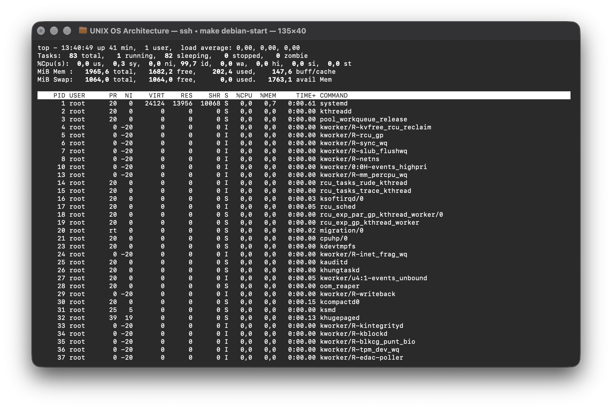
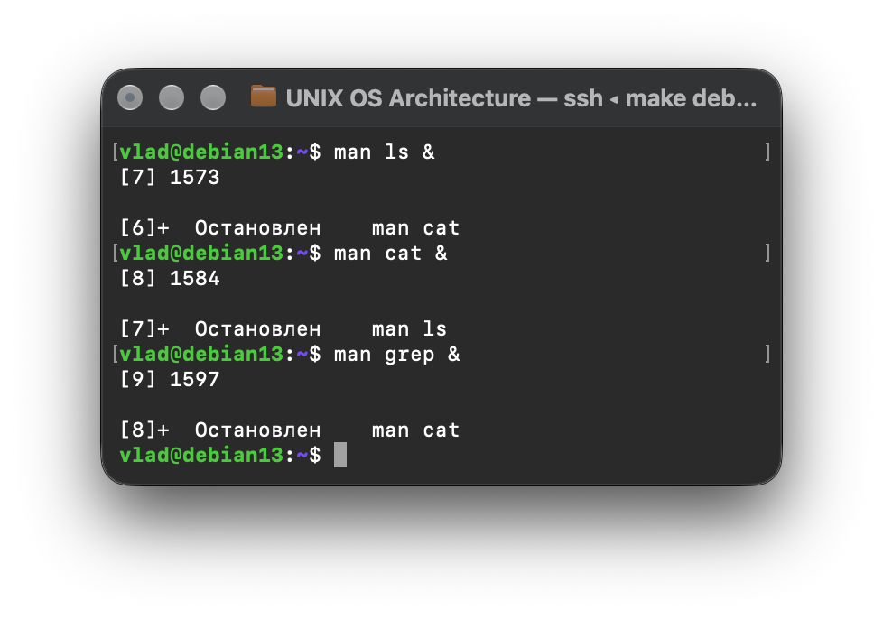
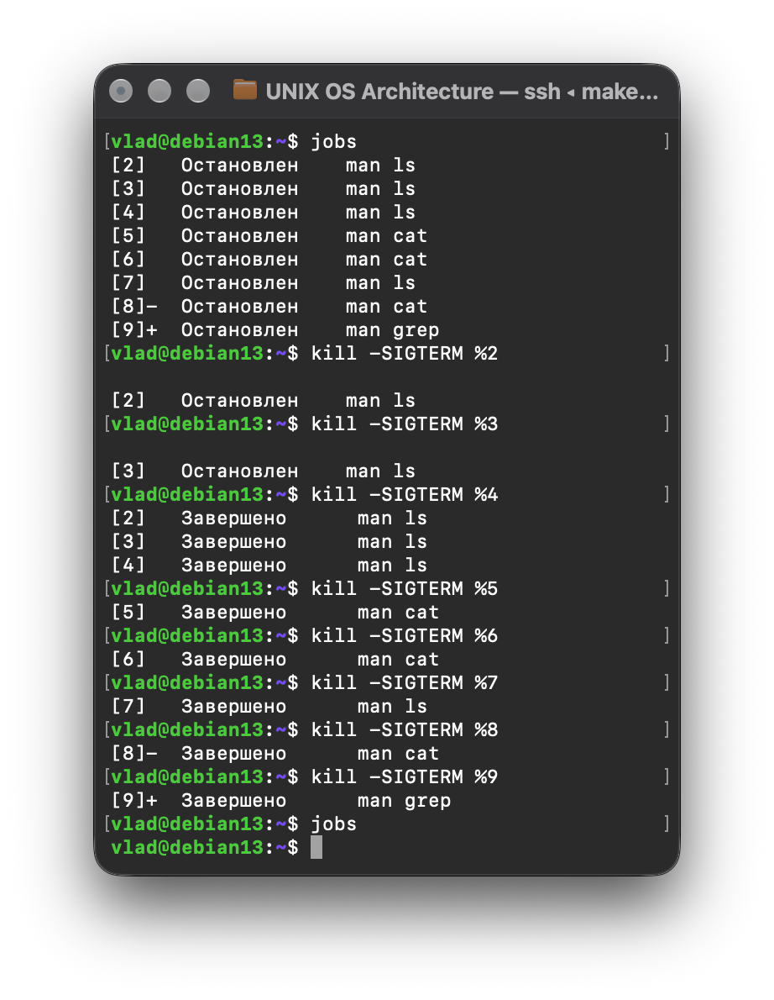

[//]: # (Работа сдана)

# Лабораторная работа №8. Процессы UNIX

## Упражнение 8.1. Типы процессов

### 1. Поиск различных типов процессов при помощи команды `ps aux`

> **Процесс** — это выполняющаяся программа вместе со всем её текущим состоянием: кодом, данными, открытыми файлами,
> значениями регистров процессора, выделенной памятью.

> `ps aux` — снимок всех процессов

```bash
vlad@debian13:~$ ps aux  
USER         PID %CPU %MEM    VSZ   RSS TTY      STAT START   TIME COMMAND
root           1  0.0  0.6  24736 14000 ?        Ss   12:53   0:00 /sbin/init
root           2  0.0  0.0      0     0 ?        S    12:53   0:00 [kthreadd]
root           3  0.0  0.0      0     0 ?        S    12:53   0:00 [pool_workque
root           4  0.0  0.0      0     0 ?        I<   12:53   0:00 [kworker/R-kv
root           5  0.0  0.0      0     0 ?        I<   12:53   0:00 [kworker/R-rc
root           6  0.0  0.0      0     0 ?        I<   12:53   0:00 [kworker/R-sy
root           7  0.0  0.0      0     0 ?        I<   12:53   0:00 [kworker/R-sl
root           8  0.0  0.0      0     0 ?        I<   12:53   0:00 [kworker/R-ne
root          10  0.0  0.0      0     0 ?        I<   12:53   0:00 [kworker/0:0H
root          13  0.0  0.0      0     0 ?        I<   12:53   0:00 [kworker/R-mm
root          14  0.0  0.0      0     0 ?        I    12:53   0:00 [rcu_tasks_ru
root          15  0.0  0.0      0     0 ?        I    12:53   0:00 [rcu_tasks_tr
root          16  0.0  0.0      0     0 ?        S    12:53   0:00 [ksoftirqd/0]
root          17  0.0  0.0      0     0 ?        I    12:53   0:00 [rcu_sched]
root          18  0.0  0.0      0     0 ?        S    12:53   0:00 [rcu_exp_par_
root          19  0.0  0.0      0     0 ?        S    12:53   0:00 [rcu_exp_gp_k
root          20  0.0  0.0      0     0 ?        S    12:53   0:00 [migration/0]
root          21  0.0  0.0      0     0 ?        S    12:53   0:00 [cpuhp/0]
root          23  0.0  0.0      0     0 ?        S    12:53   0:00 [kdevtmpfs]
root          24  0.0  0.0      0     0 ?        I<   12:53   0:00 [kworker/R-in
root          25  0.0  0.0      0     0 ?        S    12:53   0:00 [kauditd]
root          26  0.0  0.0      0     0 ?        S    12:53   0:00 [khungtaskd]
root          27  0.0  0.0      0     0 ?        I    12:53   0:00 [kworker/u4:1
root          28  0.0  0.0      0     0 ?        S    12:53   0:00 [oom_reaper]
root          29  0.0  0.0      0     0 ?        I<   12:53   0:00 [kworker/R-wr
root          30  0.0  0.0      0     0 ?        S    12:53   0:00 [kcompactd0]
root          31  0.0  0.0      0     0 ?        SN   12:53   0:00 [ksmd]
root          32  0.0  0.0      0     0 ?        SN   12:53   0:00 [khugepaged]
root          33  0.0  0.0      0     0 ?        I<   12:53   0:00 [kworker/R-ki
root          34  0.0  0.0      0     0 ?        I<   12:53   0:00 [kworker/R-kb
root          35  0.0  0.0      0     0 ?        I<   12:53   0:00 [kworker/R-bl
root          36  0.0  0.0      0     0 ?        I<   12:53   0:00 [kworker/R-tp
root          37  0.0  0.0      0     0 ?        I<   12:53   0:00 [kworker/R-ed
root          38  0.0  0.0      0     0 ?        I<   12:53   0:00 [kworker/R-de
root          39  0.0  0.0      0     0 ?        S    12:53   0:00 [watchdogd]
root          40  0.0  0.0      0     0 ?        I<   12:53   0:00 [kworker/R-qu
root          41  0.0  0.0      0     0 ?        I<   12:53   0:00 [kworker/0:1H
root          42  0.0  0.0      0     0 ?        S    12:53   0:00 [kswapd0]
root          46  0.0  0.0      0     0 ?        I    12:53   0:00 [kworker/u4:3
root          51  0.0  0.0      0     0 ?        I<   12:53   0:00 [kworker/R-kt
root          55  0.0  0.0      0     0 ?        I<   12:53   0:00 [kworker/R-ac
root          56  0.0  0.0      0     0 ?        I<   12:53   0:00 [kworker/R-ml
root          57  0.0  0.0      0     0 ?        I<   12:53   0:00 [kworker/R-ip
root          62  0.0  0.0      0     0 ?        I<   12:53   0:00 [kworker/R-ks
root          64  0.0  0.0      0     0 ?        I<   12:53   0:00 [kworker/u5:0
root         121  0.0  0.0      0     0 ?        I    12:53   0:00 [kworker/u4:4
root         173  0.0  0.0      0     0 ?        S    12:53   0:00 [scsi_eh_0]
root         174  0.0  0.0      0     0 ?        I<   12:53   0:00 [kworker/R-sc
root         210  0.0  0.0      0     0 ?        S    12:53   0:00 [jbd2/sda3-8]
root         211  0.0  0.0      0     0 ?        I<   12:53   0:00 [kworker/R-ex
root         256  0.0  0.8  51248 16404 ?        Ss   12:53   0:00 /usr/lib/syst
systemd+     297  0.0  0.3  92168  7732 ?        Ssl  12:53   0:00 /usr/lib/syst
root         302  0.0  0.4  36392  9776 ?        Ss   12:53   0:00 /usr/lib/syst
root         307  0.0  0.0      0     0 ?        S    12:53   0:00 [psimon]
root         424  0.0  0.0      0     0 ?        S    12:53   0:00 [irq/14-vmwgf
root         425  0.0  0.0      0     0 ?        I<   12:53   0:00 [kworker/R-tt
root         578  0.0  0.1   6984  2728 ?        Ss   12:53   0:00 /usr/sbin/cro
message+     592  0.0  0.2   8528  4484 ?        Ss   12:53   0:00 /usr/bin/dbus
dhcpcd       600  0.0  0.2  10112  4404 ?        S    12:53   0:00 dhcpcd: enp0s
root         601  0.0  0.1  10116  2332 ?        S    12:53   0:00 dhcpcd: [priv
dhcpcd       602  0.0  0.1  10100  2184 ?        S    12:53   0:00 dhcpcd: [netw
dhcpcd       603  0.0  0.1  10100  2180 ?        S    12:53   0:00 dhcpcd: [cont
root         605  0.0  0.4  19180  8476 ?        Ss   12:53   0:00 /usr/lib/syst
daemon       607  0.0  0.1   3928  2180 ?        Ss   12:53   0:00 /usr/sbin/atd
root         688  0.0  0.1   7716  2220 tty1     Ss+  12:53   0:00 /sbin/agetty 
root         689  0.0  0.0      0     0 ?        I<   12:53   0:00 [kworker/R-cf
root         880  0.0  0.3  11528  7424 ?        Ss   12:53   0:00 sshd: /usr/sb
Debian-+     998  0.0  1.1  41992 22968 ?        Ss   12:53   0:00 /usr/sbin/exi
dhcpcd      1004  0.0  0.1  10116  2332 ?        S    12:54   0:00 dhcpcd: [DHCP
dhcpcd      1006  0.0  0.1  10116  2268 ?        S    12:54   0:00 dhcpcd: [BPF 
dhcpcd      1023  0.0  0.1  10116  2332 ?        S    12:54   0:00 dhcpcd: [DHCP
dhcpcd      1059  0.0  0.1  10116  2332 ?        S    12:54   0:00 dhcpcd: [BOOT
root        1060  0.0  0.5  21924 11936 ?        Ss   12:54   0:00 sshd-session:
vlad        1068  0.0  0.5  22580 11804 ?        Ss   12:54   0:00 /usr/lib/syst
vlad        1070  0.0  0.1  26476  3996 ?        S    12:54   0:00 (sd-pam)
vlad        1083  0.0  0.3  22180  7368 ?        S    12:54   0:05 sshd-session:
vlad        1084  0.0  0.2   9052  5924 pts/0    Ss   12:54   0:00 -bash
dhcpcd      1107  0.0  0.1  10116  2332 ?        S    13:01   0:00 dhcpcd: [DHCP
root        1284  0.0  0.0      0     0 ?        S    13:09   0:00 [psimon]
root        1544  0.2  0.0      0     0 ?        I    14:30   0:02 [kworker/0:0-
root        1559  0.4  0.0      0     0 ?        I    14:35   0:02 [kworker/0:1-
vlad        1575  0.0  0.1   8260  3324 pts/0    T    14:40   0:00 man ls
vlad        1585  0.0  0.1   5808  2464 pts/0    T    14:40   0:00 pager
root        1590  0.7  0.0      0     0 ?        I    14:42   0:00 [kworker/0:2-
vlad        1605  100  0.1   9008  3700 pts/0    R+   14:44   0:00 ps aux
vlad@debian13:~$ 
```

* **a** — показать процессы всех пользователей (не только текущего)
* **u** — показать в «user-oriented» формате, с дополнительными колонками (владелец, % CPU, % памяти)
* **x** — включить процессы, не привязанные ни к одному управляющему терминалу

* **TTY** — управляющий терминал процесса; ? означает отсутствие терминала
* **STAT** — состояние процесса (R running, S sleeping)
* **COMMAND** в квадратных скобках [kworker/0:1] — признак потока/процесса ядра (kernel thread), не обычной
  пользовательской программы.

#### a. Системные процессы:

> Это процессы, напрямую обслуживающие работу самого ядра — чаще всего отображаются в `ps aux` с именем в квадратных
> скобках, принадлежат root, PID обычно малые числа или специфичные для подсистем ядра:

```bash
vlad@debian13:~$ ps -eo pid,ppid,user,tty,stat,cmd | awk '$2==2 || $1==2'
      2       0 root     ?        S    [kthreadd]
      3       2 root     ?        S    [pool_workqueue_release]
      4       2 root     ?        I<   [kworker/R-kvfree_rcu_reclaim]
      5       2 root     ?        I<   [kworker/R-rcu_gp]
      6       2 root     ?        I<   [kworker/R-sync_wq]
      7       2 root     ?        I<   [kworker/R-slub_flushwq]
      8       2 root     ?        I<   [kworker/R-netns]
     10       2 root     ?        I<   [kworker/0:0H-events_highpri]
     13       2 root     ?        I<   [kworker/R-mm_percpu_wq]
     14       2 root     ?        I    [rcu_tasks_rude_kthread]
     15       2 root     ?        I    [rcu_tasks_trace_kthread]
     16       2 root     ?        S    [ksoftirqd/0]
     17       2 root     ?        I    [rcu_sched]
     18       2 root     ?        S    [rcu_exp_par_gp_kthread_worker/0]
     19       2 root     ?        S    [rcu_exp_gp_kthread_worker]
     20       2 root     ?        S    [migration/0]
     21       2 root     ?        S    [cpuhp/0]
     23       2 root     ?        S    [kdevtmpfs]
     24       2 root     ?        I<   [kworker/R-inet_frag_wq]
     25       2 root     ?        S    [kauditd]
     26       2 root     ?        S    [khungtaskd]
     27       2 root     ?        I    [kworker/u4:1-events_unbound]
     28       2 root     ?        S    [oom_reaper]
     29       2 root     ?        I<   [kworker/R-writeback]
     30       2 root     ?        S    [kcompactd0]
     31       2 root     ?        SN   [ksmd]
     32       2 root     ?        SN   [khugepaged]
     33       2 root     ?        I<   [kworker/R-kintegrityd]
     34       2 root     ?        I<   [kworker/R-kblockd]
     35       2 root     ?        I<   [kworker/R-blkcg_punt_bio]
     36       2 root     ?        I<   [kworker/R-tpm_dev_wq]
     37       2 root     ?        I<   [kworker/R-edac-poller]
     38       2 root     ?        I<   [kworker/R-devfreq_wq]
     39       2 root     ?        S    [watchdogd]
     40       2 root     ?        I<   [kworker/R-quota_events_unbound]
     41       2 root     ?        I<   [kworker/0:1H-kblockd]
     42       2 root     ?        S    [kswapd0]
     46       2 root     ?        I    [kworker/u4:3-ipv6_addrconf]
     51       2 root     ?        I<   [kworker/R-kthrotld]
     55       2 root     ?        I<   [kworker/R-acpi_thermal_pm]
     56       2 root     ?        I<   [kworker/R-mld]
     57       2 root     ?        I<   [kworker/R-ipv6_addrconf]
     62       2 root     ?        I<   [kworker/R-kstrp]
     64       2 root     ?        I<   [kworker/u5:0]
    121       2 root     ?        I    [kworker/u4:4-flush-8:0]
    173       2 root     ?        S    [scsi_eh_0]
    174       2 root     ?        I<   [kworker/R-scsi_tmf_0]
    210       2 root     ?        S    [jbd2/sda3-8]
    211       2 root     ?        I<   [kworker/R-ext4-rsv-conversion]
    307       2 root     ?        S    [psimon]
    424       2 root     ?        S    [irq/14-vmwgfx]
    425       2 root     ?        I<   [kworker/R-ttm]
    689       2 root     ?        I<   [kworker/R-cfg80211]
   1284       2 root     ?        S    [psimon]
   1544       2 root     ?        I    [kworker/0:0-events]
   1559       2 root     ?        I    [kworker/0:1-events]
   1590       2 root     ?        I    [kworker/0:2-events_power_efficient]
vlad@debian13:~$ 
```

**Примеры:** `[kworker/...]` (обработчики очередей задач ядра), `[ksoftirqd/0]` (обработка софтверных прерываний),
`[migration/0]`, `[rcu_sched]`. У них нет собственного исполняемого файла на диске — они часть работы ядра, запущены не
через exec, а напрямую механизмом ядра (`kernel_thread`).

#### b. Демоны:

> Демон (daemon) — пользовательская (не ядерная) фоновая программа, обслуживающая какую-либо системную службу без
> привязки к интерактивному терминалу. Признаки в выводе `ps`:
> * `TTY = ?` — нет управляющего терминала
> * обычно имя заканчивается на `d` (традиция именования: `sshd`, `cron`, `systemd`, `rsyslogd`, `atd`)
> * запущены, как правило, от `root` или от специального служебного пользователя

```bash
vlad@debian13:~$ ps -eo pid,ppid,user,tty,stat,cmd | awk '$4=="?" && $2!=2 && $1!=2'
      1       0 root     ?        Ss   /sbin/init
    256       1 root     ?        Ss   /usr/lib/systemd/systemd-journald
    297       1 systemd+ ?        Ssl  /usr/lib/systemd/systemd-timesyncd
    302       1 root     ?        Ss   /usr/lib/systemd/systemd-udevd
    578       1 root     ?        Ss   /usr/sbin/cron -f
    592       1 message+ ?        Ss   /usr/bin/dbus-daemon --system --address=systemd: --nofork --nopidfile --systemd-activation --syslog-only
    600       1 dhcpcd   ?        S    dhcpcd: enp0s8 [ip4] [ip6]
    601     600 root     ?        S    dhcpcd: [privileged proxy] enp0s8 [ip4] [ip6]
    602     600 dhcpcd   ?        S    dhcpcd: [network proxy] enp0s8 [ip4] [ip6]
    603     600 dhcpcd   ?        S    dhcpcd: [control proxy] enp0s8 [ip4] [ip6]
    605       1 root     ?        Ss   /usr/lib/systemd/systemd-logind
    607       1 daemon   ?        Ss   /usr/sbin/atd -f
    880       1 root     ?        Ss   sshd: /usr/sbin/sshd -D [listener] 0 of 10-100 startups
    998       1 Debian-+ ?        Ss   /usr/sbin/exim4 -bdf -q30m
   1004     601 dhcpcd   ?        S    dhcpcd: [DHCP6 proxy] fe80::b7b8:e744:21a6:8423
   1006     601 dhcpcd   ?        S    dhcpcd: [BPF ARP] enp0s8 10.0.2.15
   1023     601 dhcpcd   ?        S    dhcpcd: [DHCP6 proxy] fd17:625c:f037:2:8307:51b1:887b:35
   1059     601 dhcpcd   ?        S    dhcpcd: [BOOTP proxy] 10.0.2.15
   1060     880 root     ?        Ss   sshd-session: vlad [priv]
   1068       1 vlad     ?        Ss   /usr/lib/systemd/systemd --user
   1070    1068 vlad     ?        S    (sd-pam)
   1083    1060 vlad     ?        S    sshd-session: vlad@pts/0
   1107     601 dhcpcd   ?        S    dhcpcd: [DHCP6 proxy] fd17:625c:f037:2:a00:27ff:fe0c:6ebe
vlad@debian13:~$ 
```

**Примеры:** `sshd` (сервер SSH), `cron/atd` (подсистемы отложенных заданий), `systemd-journald`, `rsyslogd`.

#### c. Пользовательские процессы:

> Процессы, запущенные интерактивно конкретным пользователем, привязанные к терминалу (TTY не ?)

```bash
vlad@debian13:~$ ps -eo pid,ppid,user,tty,stat,cmd | awk '$4!="?"' 
    PID    PPID USER     TT       STAT CMD
    688       1 root     tty1     Ss+  /sbin/agetty -o -- \u --noreset --noclear - linux
   1084    1083 vlad     pts/0    Ss   -bash
   1575    1084 vlad     pts/0    T    man ls
   1585    1575 vlad     pts/0    T    pager
   1610    1084 vlad     pts/0    R+   ps -eo pid,ppid,user,tty,stat,cmd
   1611    1084 vlad     pts/0    S+   awk $4!="?"
vlad@debian13:~$ 
```

**Примеры:** оболочка `bash`, запущенный `vim`, сама команда `ps`, которая выполняется.

### 2. Процессы, порожденные от процесса `init` (`ps afx`)

> `ps afx` — дерево процессов

* `f (forest)` — выводит процессы в виде дерева, с ASCII-графикой (\_), наглядно показывающей родительско-дочерние связи
* `x` — снова включает процессы без терминала (иначе дерево будет неполным, потеряется часть иерархии)

```bash
vlad@debian13:~$ ps afx
    PID TTY      STAT   TIME COMMAND
      2 ?        S      0:00 [kthreadd]
      3 ?        S      0:00  \_ [pool_workqueue_release]
      4 ?        I<     0:00  \_ [kworker/R-kvfree_rcu_reclaim]
      5 ?        I<     0:00  \_ [kworker/R-rcu_gp]
      6 ?        I<     0:00  \_ [kworker/R-sync_wq]
      7 ?        I<     0:00  \_ [kworker/R-slub_flushwq]
      8 ?        I<     0:00  \_ [kworker/R-netns]
     10 ?        I<     0:00  \_ [kworker/0:0H-events_highpri]
     13 ?        I<     0:00  \_ [kworker/R-mm_percpu_wq]
     14 ?        I      0:00  \_ [rcu_tasks_rude_kthread]
     15 ?        I      0:00  \_ [rcu_tasks_trace_kthread]
     16 ?        S      0:00  \_ [ksoftirqd/0]
     17 ?        I      0:00  \_ [rcu_sched]
     18 ?        S      0:00  \_ [rcu_exp_par_gp_kthread_worker/0]
     19 ?        S      0:00  \_ [rcu_exp_gp_kthread_worker]
     20 ?        S      0:00  \_ [migration/0]
     21 ?        S      0:00  \_ [cpuhp/0]
     23 ?        S      0:00  \_ [kdevtmpfs]
     24 ?        I<     0:00  \_ [kworker/R-inet_frag_wq]
     25 ?        S      0:00  \_ [kauditd]
     26 ?        S      0:00  \_ [khungtaskd]
     27 ?        I      0:00  \_ [kworker/u4:1-flush-8:0]
     28 ?        S      0:00  \_ [oom_reaper]
     29 ?        I<     0:00  \_ [kworker/R-writeback]
     30 ?        S      0:00  \_ [kcompactd0]
     31 ?        SN     0:00  \_ [ksmd]
     32 ?        SN     0:00  \_ [khugepaged]
     33 ?        I<     0:00  \_ [kworker/R-kintegrityd]
     34 ?        I<     0:00  \_ [kworker/R-kblockd]
     35 ?        I<     0:00  \_ [kworker/R-blkcg_punt_bio]
     36 ?        I<     0:00  \_ [kworker/R-tpm_dev_wq]
     37 ?        I<     0:00  \_ [kworker/R-edac-poller]
     38 ?        I<     0:00  \_ [kworker/R-devfreq_wq]
     39 ?        S      0:00  \_ [watchdogd]
     40 ?        I<     0:00  \_ [kworker/R-quota_events_unbound]
     41 ?        I<     0:00  \_ [kworker/0:1H-kblockd]
     42 ?        S      0:00  \_ [kswapd0]
     46 ?        I      0:00  \_ [kworker/u4:3-flush-8:0]
     51 ?        I<     0:00  \_ [kworker/R-kthrotld]
     55 ?        I<     0:00  \_ [kworker/R-acpi_thermal_pm]
     56 ?        I<     0:00  \_ [kworker/R-mld]
     57 ?        I<     0:00  \_ [kworker/R-ipv6_addrconf]
     62 ?        I<     0:00  \_ [kworker/R-kstrp]
     64 ?        I<     0:00  \_ [kworker/u5:0]
    123 ?        I      0:00  \_ [kworker/u4:4-events_unbound]
    172 ?        I      0:02  \_ [kworker/0:2-events]
    173 ?        S      0:00  \_ [scsi_eh_0]
    174 ?        I<     0:00  \_ [kworker/R-scsi_tmf_0]
    209 ?        S      0:00  \_ [jbd2/sda3-8]
    210 ?        I<     0:00  \_ [kworker/R-ext4-rsv-conversion]
    308 ?        S      0:00  \_ [psimon]
    425 ?        S      0:00  \_ [irq/14-vmwgfx]
    426 ?        I<     0:00  \_ [kworker/R-ttm]
    697 ?        I<     0:00  \_ [kworker/R-cfg80211]
    998 ?        S      0:00  \_ [psimon]
   1040 ?        I      0:01  \_ [kworker/0:0-events_power_efficient]
   1108 ?        I      0:00  \_ [kworker/0:1-events]
   1129 ?        I      0:00  \_ [kworker/u4:0-flush-8:0]
      1 ?        Ss     0:00 /sbin/init
    252 ?        Ss     0:00 /usr/lib/systemd/systemd-journald
    298 ?        Ssl    0:00 /usr/lib/systemd/systemd-timesyncd
    306 ?        Ss     0:00 /usr/lib/systemd/systemd-udevd
    579 ?        Ss     0:00 /usr/sbin/cron -f
    593 ?        Ss     0:00 /usr/bin/dbus-daemon --system --address=systemd: --nofork --nopidfile --systemd-activation --syslog-only
    600 ?        Ss     0:00 /usr/lib/systemd/systemd-logind
    602 ?        S      0:00 dhcpcd: enp0s8 [ip4] [ip6]
    603 ?        S      0:00  \_ dhcpcd: [privileged proxy] enp0s8 [ip4] [ip6]
    937 ?        S      0:00  |   \_ dhcpcd: [BPF ARP] enp0s8 10.0.2.15
    938 ?        S      0:00  |   \_ dhcpcd: [DHCP6 proxy] fe80::b7b8:e744:21a6:8423
    954 ?        S      0:00  |   \_ dhcpcd: [DHCP6 proxy] fd17:625c:f037:2:8307:51b1:887b:35
    991 ?        S      0:00  |   \_ dhcpcd: [BOOTP proxy] 10.0.2.15
   1037 ?        S      0:00  |   \_ dhcpcd: [DHCP6 proxy] fd17:625c:f037:2:a00:27ff:fe0c:6ebe
    604 ?        S      0:00  \_ dhcpcd: [network proxy] enp0s8 [ip4] [ip6]
    605 ?        S      0:00  \_ dhcpcd: [control proxy] enp0s8 [ip4] [ip6]
    608 ?        Ss     0:00 /usr/sbin/atd -f
    685 tty1     Ss+    0:00 /sbin/agetty -o -- \u --noreset --noclear - linux
    755 ?        Ss     0:00 sshd: /usr/sbin/sshd -D [listener] 0 of 10-100 startups
    992 ?        Ss     0:00  \_ sshd-session: vlad [priv]
   1015 ?        S      0:00      \_ sshd-session: vlad@pts/0
   1016 pts/0    Ss     0:00          \_ -bash
   1130 pts/0    R+     0:00              \_ ps afx
    930 ?        Ss     0:00 /usr/sbin/exim4 -bdf -q30m
   1000 ?        Ss     0:00 /usr/lib/systemd/systemd --user
   1002 ?        S      0:00  \_ (sd-pam)
#############################################################################
vlad@debian13:~$ ps -eo pid,ppid,tty,stat,time,cmd --forest | sed -n '/ \/sbin\/init/,$p'
      1       0 ?        Ss   00:00:00 /sbin/init
    256       1 ?        Ss   00:00:00 /usr/lib/systemd/systemd-journald
    297       1 ?        Ssl  00:00:00 /usr/lib/systemd/systemd-timesyncd
    302       1 ?        Ss   00:00:00 /usr/lib/systemd/systemd-udevd
    578       1 ?        Ss   00:00:00 /usr/sbin/cron -f
    592       1 ?        Ss   00:00:00 /usr/bin/dbus-daemon --system --address=systemd: --nofork --nopidfile --systemd-activation --syslog-only
    600       1 ?        S    00:00:00 dhcpcd: enp0s8 [ip4] [ip6]
    601     600 ?        S    00:00:00  \_ dhcpcd: [privileged proxy] enp0s8 [ip4] [ip6]
   1004     601 ?        S    00:00:00  |   \_ dhcpcd: [DHCP6 proxy] fe80::b7b8:e744:21a6:8423
   1006     601 ?        S    00:00:00  |   \_ dhcpcd: [BPF ARP] enp0s8 10.0.2.15
   1023     601 ?        S    00:00:00  |   \_ dhcpcd: [DHCP6 proxy] fd17:625c:f037:2:8307:51b1:887b:35
   1059     601 ?        S    00:00:00  |   \_ dhcpcd: [BOOTP proxy] 10.0.2.15
   1107     601 ?        S    00:00:00  |   \_ dhcpcd: [DHCP6 proxy] fd17:625c:f037:2:a00:27ff:fe0c:6ebe
    602     600 ?        S    00:00:00  \_ dhcpcd: [network proxy] enp0s8 [ip4] [ip6]
    603     600 ?        S    00:00:00  \_ dhcpcd: [control proxy] enp0s8 [ip4] [ip6]
    605       1 ?        Ss   00:00:00 /usr/lib/systemd/systemd-logind
    607       1 ?        Ss   00:00:00 /usr/sbin/atd -f
    688       1 tty1     Ss+  00:00:00 /sbin/agetty -o -- \u --noreset --noclear - linux
    880       1 ?        Ss   00:00:00 sshd: /usr/sbin/sshd -D [listener] 0 of 10-100 startups
   1060     880 ?        Ss   00:00:00  \_ sshd-session: vlad [priv]
   1083    1060 ?        S    00:00:05      \_ sshd-session: vlad@pts/0
   1084    1083 pts/0    Ss   00:00:00          \_ -bash
   1575    1084 pts/0    T    00:00:00              \_ man ls
   1585    1575 pts/0    T    00:00:00              |   \_ pager
   1646    1084 pts/0    R+   00:00:00              \_ ps -eo pid,ppid,tty,stat,time,cmd --forest
   1647    1084 pts/0    S+   00:00:00              \_ sed -n / \/sbin\/init/,$p
    998       1 ?        Ss   00:00:00 /usr/sbin/exim4 -bdf -q30m
   1068       1 ?        Ss   00:00:00 /usr/lib/systemd/systemd --user
   1070    1068 ?        S    00:00:00  \_ (sd-pam)
vlad@debian13:~$ 
```

Это наглядно демонстрирует фундаментальный принцип: каждый процесс в UNIX порождается другим процессом через системный
вызов `fork()` (создание копии процесса) с последующим, часто, `exec()` (заменой кода на новую программу) — за
исключением самого первого процесса системы.

### 3. Цепочка порождаемых процессов от процесса `init` до процесса `ps`

> `init` (в современных системах — `systemd`, но символическая ссылка `/sbin/init` на него сохраняется для
> совместимости) — это самый первый процесс, запускаемый ядром при загрузке, всегда с `PID = 1`. У него нет родителя в
> обычном смысле (его «родитель» — само ядро). Все остальные процессы системы — его прямые или косвенные потомки.

Если родительский процесс завершается раньше своих детей, эти дочерние процессы не остаются «висеть в воздухе» — ядро
автоматически переподчиняет их `init` (reparenting). Поэтому `init` — не просто первый процесс, а постоянный
«страховочный» родитель для всей системы.

```bash
vlad@debian13:~$ pstree -sp $$
systemd(1)───sshd(880)───sshd-session(1060)───sshd-session(1083)───bash(1084)───pstree(1718)
vlad@debian13:~$                                                                └─pstree(1665)
vlad@debian13:~$ pstree -p 1
systemd(1)─┬─agetty(688)
           ├─atd(607)
           ├─cron(578)
           ├─dbus-daemon(592)
           ├─dhcpcd(600)─┬─dhcpcd(601)─┬─dhcpcd(1004)
           │             │             ├─dhcpcd(1006)
           │             │             ├─dhcpcd(1023)
           │             │             ├─dhcpcd(1059)
           │             │             └─dhcpcd(1107)
           │             ├─dhcpcd(602)
           │             └─dhcpcd(603)
           ├─exim4(998)
           ├─sshd(880)───sshd-session(1060)───sshd-session(1083)───bash(1084)───pstree(1719)
           ├─systemd(1068)───(sd-pam)(1070)
           ├─systemd-journal(256)
           ├─systemd-logind(605)
           ├─systemd-timesyn(297)───{systemd-timesyn}(306)
           └─systemd-udevd(302)
vlad@debian13:~$ 
```

* `$$` — специальная переменная `bash`, содержащая `PID` текущего процесса `shell`.
* `pstree` покажет компактное дерево
  именно от текущего процесса вверх и вниз, с `PID` в скобках благодаря флагу `-p`.

---

## Упражнение 8.2. Атрибуты процессов

### 1. Запуск программы `top` и вызов справки по клавише `h`

> `top` — динамический мониторинг



В отличие от `ps` (статичный «снимок» в момент вызова), `top` обновляет данные в реальном времени (по умолчанию каждые 3
секунды), показывая сверху сводную информацию о системе (загрузка, память), а ниже — таблицу процессов, отсортированную
обычно по убыванию загрузки CPU.


* `k` — послать сигнал процессу (запросит PID и номер сигнала);
* `r` — изменить nice-значение (приоритет) процесса (renice);
* `q` — выйти;
* `f` — выбор/настройка отображаемых полей (Fields management);
* `o` — изменить сортировку.

### 2. Отображение полей: PID, PPID, NI, UID, PRI, TTY, USER

| Поле | Значение                                               |
|------|--------------------------------------------------------|
| PID  | идентификатор процесса (Process ID)                    |
| PPID | идентификатор родительского процесса (Parent PID)      |
| NI   | значение nice — пользовательский приоритет             |
| UID  | числовой идентификатор пользователя-владельца процесса |
| PRI  | фактический приоритет планирования ядра                |
| TTY  | управляющий терминал процесса                          |
| USER | имя пользователя-владельца                             |

> `NI (nice value) `— значение, которое пользователь может установить в диапазоне от −20 (наивысший приоритет) до +19
> (наименьший приоритет), влияющее на то, сколько процессорного времени планировщик будет выделять процессу относительно
> других;

> `PRI (priority)` — реальный приоритет, с которым ядро фактически планирует процесс, вычисляемый планировщиком на
> основе `NI` и других факторов (типа процесса, истории использования CPU). Обычная формула связи в Linux:
> `PRI = 20 + NI`
> (базовое значение приоритета 20 для обычных процессов).


### 3. Изменение атрибута NICE процесса `top`


Обычный пользователь может только повышать численное значение NI (то есть понижать реальный приоритет своего процесса —
"быть добрее" к другим) в диапазоне от текущего до +19. Понижать `NI` ниже 0 (повышать реальный приоритет) разрешено
только `root`.

```bash
renice -n -5 -p 1234        # обычный пользователь — ошибка без sudo
sudo renice -n -5 -p 1234   # с правами root — сработает
nice -n 10 команда          # запустить новую команду сразу с заданным nice
```

---

## Упражнение 8.3. Задания и сигналы

> Сигнал — это способ ядра (или другого процесса) асинхронно уведомить процесс о каком-либо событии, прервав его
> нормальное выполнение для обработки. У каждого сигнала есть номер и символическое имя, а также поведение по умолчанию
> (`terminate`, `ignore`, `stop`, `continue` и т.д.), которое процесс может переопределить (установить свой
> обработчик) — за исключением `SIGKILL` и `SIGSTOP`, которые нельзя ни перехватить, ни заблокировать в принципе.

| Комбинация    | Сигнал                    | Номер | Поведение по умолчанию                                                |
|:--------------|:--------------------------|:------|:----------------------------------------------------------------------|
| **Ctrl + C**  | `SIGINT` (interrupt)      | 2     | Завершение процесса (перехватываемый)                                 |
| **Ctrl + \\** | `SIGQUIT` (quit)          | 3     | Завершение процесса с созданием core-дампа (дампа памяти для отладки) |
| **Ctrl + Z**  | `SIGTSTP` (terminal stop) | 20    | Приостановка процесса (не завершение!)                                |

### 1-2. Запуск `man` на переднем фоне и завершение через `^C` (SIGINT)

**Ожидаемый результат:** процесс `less` (пейджер man) немедленно завершается, управление сразу возвращается в `shell`.
Это стандартное поведение прерывания — большинство интерактивных программ реагируют на `SIGINT` корректным завершением.

### 3-4. Запуск `man` на переднем фоне и завершение через `^\` (SIGQUIT)

**Ожидаемая реакция:** процесс тоже завершается, но может появиться сообщение в терминале вроде: `Quit (core dumped)`.
Это означает, что система попыталась создать core dump — файл с образом памяти процесса на момент получения сигнала,
используемый для отладки.

### 5-6. Запуск `man` на переднем фоне и приостановка через `^Z` (SIGTSTP)

Процесс не завершается, а приостанавливается (переходит в состояние T — stopped), оставаясь в памяти со всем своим
состоянием. `Shell` сразу выводит сообщение: `[1]+ Stopped man ls`
`Составляющие:` `[1]` — номер задания (job number, не PID!), `+` — признак «текущего» задания (most recently
referenced),
`Stopped` — состояние, `man ls` — исходная командная строка.


### 7. Использование команд `fg` и `bg` для приостановленного задания

> Задания (job) — это абстракция `shell`, а не ядра: `shell` отслеживает группы процессов, запущенные из текущей
> интерактивной сессии, присваивая им номера заданий для удобного управления (в отличие от PID, которые выдаёт ядро
> глобально для всей системы).

```bash
fg          # возобновить последнее остановленное/фоновое задание на переднем плане
fg %1       # возобновить конкретно задание с номером 1 на переднем плане
bg          # возобновить выполнение в фоне (background), не блокируя terminal
bg %1       # то же для конкретного задания
```

* `fg` отправляет процессу сигнал `SIGCONT` (continue) и переключает его на передний план — терминал снова блокируется,
  ожидая его завершения;
* `bg` тоже отправляет `SIGCONT`, но оставляет задание работать в фоне, не блокируя ввод — получаешь обратно приглашение
  shell, пока задание работает параллельно.

### 8. Последовательный запуск нескольких процессов `man` в фоне



Составляющие: `[N]` — номер задания (JOBID, локальный для текущего сеанса shell), число после — `PID` (глобальный
идентификатор процесса в системе, присвоенный ядром). JOBID нумеруется с 1 заново в каждой сессии shell и имеет смысл
только внутри неё, тогда как `PID` — глобальный и уникальный на уровне всей системы в данный момент времени.

### 9. Просмотр списка выполняющихся заданий командой `jobs`

```bash
vlad@debian13:~$ jobs
[1]   Остановлен    man ls
[2]   Остановлен    man ls
[3]   Остановлен    man ls
[4]   Остановлен    man ls
[5]   Остановлен    man cat
[6]   Остановлен    man cat
[7]   Остановлен    man ls
[8]-  Остановлен    man cat
[9]+  Остановлен    man grep
vlad@debian13:~$ 
```

Обозначения + (текущее задание, на которое сошлётся fg/bg без аргументов) и - (предыдущее по значимости задание)

### 10. Отправка сигналов различным заданиям при помощи команды `kill`



| Сигнал      | Номер | Эффект                                                  | Перехватываемость                                            |
|:------------|:------|:--------------------------------------------------------|:-------------------------------------------------------------|
| **SIGINT**  | 2     | Прерывание, как Ctrl+C                                  | да                                                           |
| **SIGTERM** | 15    | «Вежливое» завершение (поведение по умолчанию для kill) | да                                                           |
| **SIGQUIT** | 3     | Завершение с core dump                                  | да                                                           |
| **SIGKILL** | 9     | Немедленное принудительное завершение                   | нет, нельзя перехватить/заблокировать                        |
| **SIGSTOP** | 19    | Принудительная приостановка                             | нет, нельзя перехватить/заблокировать                        |
| **SIGCONT** | 18    | Возобновление после остановки                           | да (но обычно не перехватывается, используется по умолчанию) |

```bash
kill -SIGTERM %2     # вежливо попросить задание 2 завершиться
kill -SIGKILL %2     # принудительно убить задание 2, если SIGTERM не подействовал
kill -SIGSTOP %3     # заморозить задание 3 (аналог Ctrl+Z, но можно применить к любому процессу, не только переднего плана)
kill -SIGCONT %3     # разморозить его
```

Разница между `SIGTERM` и `SIGKILL` принципиальна. `SIGTERM` даёт процессу шанс корректно завершиться — закрыть открытые
файлы, сохранить состояние, освободить ресурсы (если у процесса есть обработчик сигнала) — это «вежливая просьба».
`SIGKILL` — это прямое действие ядра, уничтожающее процесс немедленно, без какого-либо участия самого процесса (он даже
не узнает о попытке завершения) — используется как крайняя мера, когда процесс завис и не реагирует на `SIGTERM`.
Аналогично `SIGSTOP`/`SIGCONT` — это «неперехватываемые» версии `SIGTSTP` (`Ctrl+Z` можно переопределить в обработчике
процесса, а `SIGSTOP` — никогда).