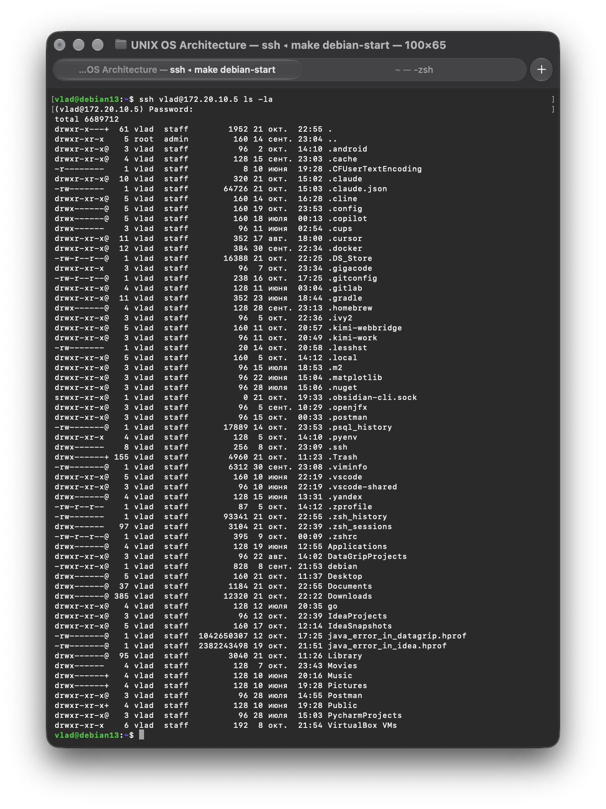
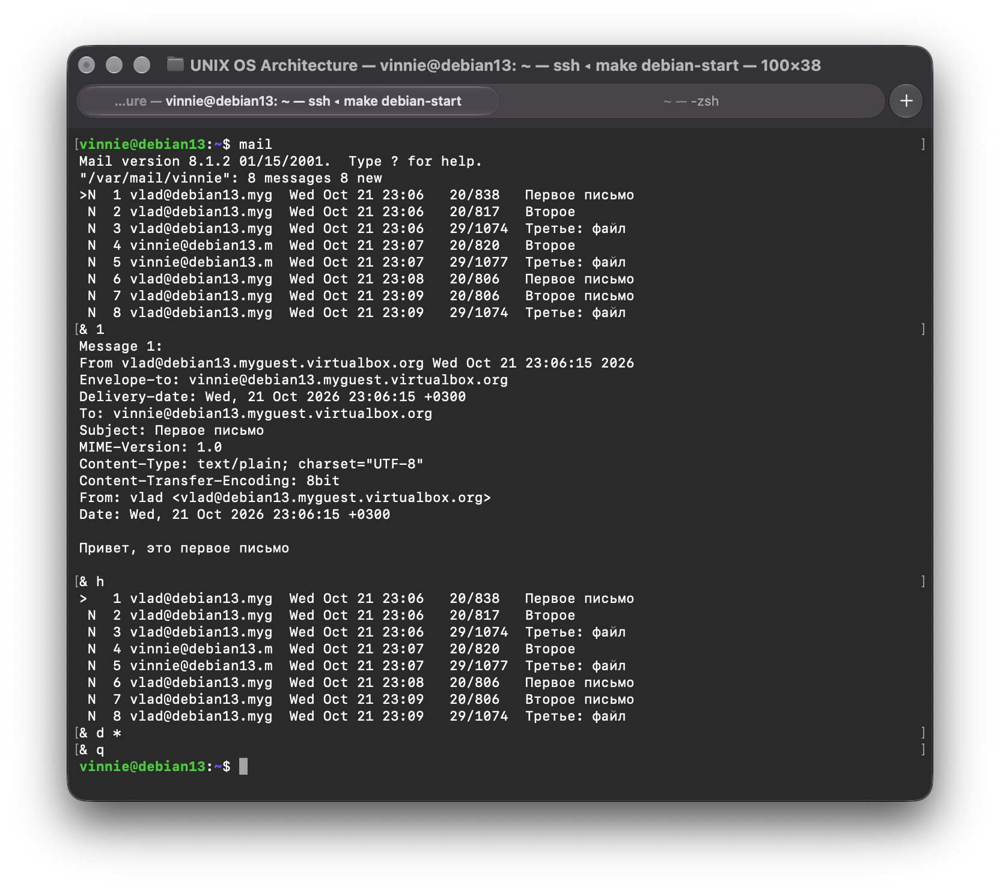

[//]: # (Работа выполнена)

# Лабораторная работа 9. Сетевое окружение UNIX

## Упражнение 9.1. Удаленный доступ в систему с помощью протокола SSH

### 1. При помощи команды ssh подключитесь к операционной системе соседа:

> SSH (Secure Shell) — протокол удалённого входа поверх TCP, порт 22. Весь трафик шифруется.

```bash
# на macbook получил ip-адрес
vlad@MacBook-Air-vlad ~ % ipconfig getifaddr en0
172.20.10.5

# на виртуальной машине
vlad@debian13:~$ ssh vlad@172.20.10.5
(vlad@172.20.10.5) Password:
Last login: Wed Oct 21 22:47:31 2026 from 172.20.10.5
vlad@MacBook-Air-vlad ~ % 
```

### 2. При помощи следующих команд: whoami, w, who, users, id, date, uname, tty, uptime получите информацию о УДАЛЕННОЙ системе и пользователях и зафиксируйте ее:

* a. имя текущего пользователя:

```bash
vlad@MacBook-Air-vlad ~ % whoami
vlad
```

* b. его идентификаторы UID, GID и идентификаторы вторичных групп:

```bash
vlad@MacBook-Air-vlad ~ % id
uid=501(vlad) gid=20(staff) groups=20(staff),12(everyone),61(localaccounts),79(_appserverusr),80(admin),81(_appserveradm),701(com.apple.sharepoint.group.1),33(_appstore),98(_lpadmin),100(_lpoperator),204(_developer),250(_analyticsusers),395(com.apple.access_ftp),398(com.apple.access_screensharing),400(com.apple.access_remote_ae)
vlad@MacBook-Air-vlad ~ % 
```

* c. количество и имена пользователей, работающих в системе:

```bash
vlad@MacBook-Air-vlad ~ % who   
vlad             console      16 окт. 10:51 
vlad             ttys000      21 окт. 20:34 
vlad             ttys001      21 окт. 22:39 
vlad             ttys002      21 окт. 22:49 (172.20.10.5)
vlad@MacBook-Air-vlad ~ % users                 
vlad
vlad@MacBook-Air-vlad ~ % w  
22:52  up 5 days, 12:02, 4 users, load averages: 3,16 3,76 4,16
USER       TTY      FROM          LOGIN@  IDLE WHAT
vlad       console  -            пт10    5days -
vlad       s000     -            20:34       - ssh vlad@localhost -p 2222
vlad       s001     -            22:39       5 -zsh
vlad       s002     172.20.10.5  22:49       - w
vlad@MacBook-Air-vlad ~ % 
```

* d. имя текущего виртуального терминала:

```bash
vlad@MacBook-Air-vlad ~ % tty 
/dev/ttys002
vlad@MacBook-Air-vlad ~ % 
```

* e. системная дата и время:

```bash
vlad@MacBook-Air-vlad ~ % date             
среда, 21 октября 2026 г. 22:53:08 (MSK)
vlad@MacBook-Air-vlad ~ % 
```

* f. версия операционной системы компьютера:

```bash
vlad@MacBook-Air-vlad ~ % uname -a         
Darwin MacBook-Air-vlad.local 27.0.0 Darwin Kernel Version 27.0.0: Tue Aug 11 21:02:16 PDT 2026; root:xnu-13432.1.9~1/RELEASE_ARM64_T8112 arm64
vlad@MacBook-Air-vlad ~ % sw_vers          
ProductName:		macOS
ProductVersion:		27.0
BuildVersion:		26A428
vlad@MacBook-Air-vlad ~ % 
```

* g. время работы операционной системы от момента запуска и нагрузку на операционную систему:

```bash
vlad@MacBook-Air-vlad ~ % uptime  
22:54  up 5 days, 12:05, 4 users, load averages: 5,90 4,46 4,37
vlad@MacBook-Air-vlad ~ % 
```

### 3. Закончите сеанс работы в операционной системе на машине соседа.

```bash
vlad@MacBook-Air-vlad ~ % exit
Connection to 172.20.10.5 closed.
vlad@debian13:~$ 
```

### 4. При помощи команды ssh запустите команду вывода полной информации о файлах домашнего каталога на УДАЛЕННОЙ операционной системе машины соседа, проследите за появляющимися сообщениями:



Отличия от обычного входа: нет приветствия (MOTD), нет приглашения оболочки. Удалённый `sshd` запускает команду, выводит
её результат и сразу закрывает соединение. Псевдотерминал при этом не выделяется. Если поставить флаг `-t`, терминал
выделится принудительно.

---

## Упражнение 9.2. Локальная и сетевая почта

Почтовая система UNIX состоит из нескольких частей:

* MUA (Mail User Agent) — программа пользователя для чтения и отправки писем: mail, mutt.
* MTA (Mail Transfer Agent) — демон, который доставляет почту.
* Почтовый ящик: письма пользователя хранятся в файле /var/mail/vinnie

### 1. При помощи команды mail пошлите несколько писем различного содержания пользователю vinnie, проследите за появляющимися сообщениями:

```bash
vlad@debian13:~$ mail -s "Первое письмо" vinnie
Hello, vinnie!
Cc: 
vlad@debian13:~$ echo "Hello, vinnie2" | mail -s "Второе письмо" vinnie
vlad@debian13:~$ mail -s "Третье: файл" vinnie < /etc/os-release
vlad@debian13:~$ sudo ls -l /var/mail/ 
итого 12
-rw-rw---- 1 vinnie mail 7312 окт 21 23:09 vinnie
-rw-rw---- 1 vlad   mail 3724 окт 21 23:07 vlad
vlad@debian13:~$ sudo tail /var/log/exim4/mainlog 
2026-10-21 23:07:44 1xJcbA-000000000YB-02TT Completed
2026-10-21 23:08:49 1xJccD-000000000YS-4AUw <= vlad@debian13.myguest.virtualbox.org U=vlad P=local S=587
2026-10-21 23:08:50 1xJccD-000000000YS-4AUw => vinnie <vinnie@debian13.myguest.virtualbox.org> R=local_user T=mail_spool
2026-10-21 23:08:50 1xJccD-000000000YS-4AUw Completed
2026-10-21 23:09:21 1xJccj-000000000YZ-2dFw <= vlad@debian13.myguest.virtualbox.org U=vlad P=local S=587
2026-10-21 23:09:21 1xJccj-000000000YZ-2dFw => vinnie <vinnie@debian13.myguest.virtualbox.org> R=local_user T=mail_spool
2026-10-21 23:09:21 1xJccj-000000000YZ-2dFw Completed
2026-10-21 23:09:41 1xJcd3-000000000Ye-3Pc0 <= vlad@debian13.myguest.virtualbox.org U=vlad P=local S=855
2026-10-21 23:09:41 1xJcd3-000000000Ye-3Pc0 => vinnie <vinnie@debian13.myguest.virtualbox.org> R=local_user T=mail_spool
2026-10-21 23:09:41 1xJcd3-000000000Ye-3Pc0 Completed
vlad@debian13:~$ 
```

### 2. Прочитайте и удалите прочитанные письма пользователя vinnie, проследите за появляющимися сообщениями:



```bash
vinnie@debian13:~$ mail
No mail for vinnie
vinnie@debian13:~$ 
```

| Команда                        | Действие                                 |
|:-------------------------------|:-----------------------------------------|
| **1** или **p 1**              | прочитать письмо №1                      |
| **h**                          | заново показать список заголовков        |
| **d 1** / **d 1-3** / **d \*** | удалить одно письмо / диапазон / все     |
| **q**                          | выйти с сохранением изменений            |
| **x**                          | выйти без изменений (удаление отменится) |

---

## Упражнение 9.3. Передача файлов с помощью протокола FTP

### 1. При помощи команды ftp подключитесь к серверу ftp.yandex.ru (анонимно - учетная запись anonymous), проследите за появляющимися сообщениями:

```bash
vlad@debian13:~$ ftp ftp.yandex.ru
Trying 213.180.204.183:21 ...
Connected to mirror.yandex.ru.
421 Service not available, remote server has closed connection.
```

Сервер принял TCP-соединение на порт 21, но сразу ответил кодом `421` и закрыл соединение. Это значит, что FTP-служба на
нём недоступна. Последующие попытки завершились ошибкой `Временный сбой в разрешении имен` ещё до подключения к серверу,
поэтому на них ответа сервера нет.

Дальше работа выполнена на анонимном FTP-сервере **ftp.gnu.org**: та же процедура, другой сервер.

```bash
vlad@debian13:~$ ftp ftp.gnu.org
Trying 209.51.188.20:21 ...
Connected to ftp.gnu.org.
220 GNU FTP server ready.
Name (ftp.gnu.org:vlad): anonymous
230-NOTICE (Updated October 15 2021):
230-
230-If you maintain scripts used to access ftp.gnu.org over FTP,
230-we strongly encourage you to change them to use HTTPS instead.
230-
230-Eventually we hope to shut down FTP protocol access, but plan
230-to give notice here and other places for several months ahead
230-of time.
...
230 Login successful.
Remote system type is UNIX.
Using binary mode to transfer files.
```

- `220` — сервер готов к работе;
- `Name (...)` — клиент запросил имя пользователя; `anonymous` — анонимный вход без личного пароля;
- `230` — вход выполнен. Строки `230-` — текст уведомления сервера (многострочный ответ, последняя строка с `230 ` без
  дефиса);
- `Remote system type is UNIX` — клиент определил тип удалённой системы;
- `Using binary mode` — по умолчанию клиент передаёт файлы в двоичном режиме.

В уведомлении сервер рекомендует переходить на HTTPS, так как FTP в будущем могут отключить.

### 2. Перейдите в каталог /debian/dists/jessie, проследите за появляющимися сообщениями:

```bash
ftp> cd /debian/dists/jessie
550 Failed to change directory.
```

Каталога `/debian/dists/jessie` на ftp.gnu.org нет: этот сервер хранит архив проекта GNU, а не дистрибутив Debian. Путь
из методички относится к зеркалу Debian. Код `550` означает, что каталог или файл недоступен.

Для продолжения работы посмотрите содержимое каталога `gnu` и перейдите в него:

```bash
ftp> ls gnu
ftp> cd gnu/
250 Directory successfully changed.
ftp> pwd
Remote directory: /gnu
```

Код `250` — команда выполнена успешно. Удалённый каталог теперь `/gnu`. Команда `pwd` показывает текущий каталог на
**удалённом** сервере.

### 3. Получите с удаленного сервера файл ChangeLog, проследите за появляющимися сообщениями:

```bash
ftp> cd /
250 Directory successfully changed.
ftp> binary
200 Switching to Binary mode.
ftp> get ChangeLog
local: ChangeLog remote: ChangeLog
229 Entering Extended Passive Mode (|||23087|)
550 Failed to open file.
ftp> !ls -l ChangeLog
ls: невозможно получить доступ к 'ChangeLog': Нет такого файла или каталога
```

Файла `ChangeLog` в каталоге `/` на ftp.gnu.org нет, поэтому получить его не удалось. Строка
`local: ChangeLog remote: ChangeLog` показывает, как клиент назвал файл локально и на сервере. Код
`229 Entering Extended Passive Mode` означает переход в пассивный режим: сервер сообщает порт, по которому откроет
соединение для данных. Код `550` при этом означает, что сам файл не открылся. Команда `!ls` выполняется на **локальной**
машине и подтверждает, что файл не появился.

Чтобы выполнить задание, скачайте файл, который есть на сервере. Содержимое листинга `ls` видно в сеансе выше, поэтому
возьмём `README`:

```bash
ftp> binary
200 Switching to Binary mode.
ftp> get README
local: README remote: README
229 Entering Extended Passive Mode (|||27355|)
150 Opening BINARY mode data connection for README (2814 bytes).
100% |***********************************|  2814        8.28 MiB/s    00:00 ETA
226 Transfer complete.
2814 bytes received in 00:00 (19.12 KiB/s)
ftp> !ls -l README
-rw-rw-r-- 1 vlad vlad 2814 дек 31  2025 README
```

- `150` — сервер открыл соединение для данных и готов передавать файл;
- `226 Transfer complete` — передача завершена успешно;
- строка с прогрессом показывает размер (2814 байт) и скорость. Размер совпадает с размером файла в листинге сервера,
  значит передача прошла полностью.

### 4. Закончите сеанс работы с командой ftp, проследите за появляющимися сообщениями:

```bash
ftp> bye
221 Goodbye.
vlad@debian13:~$
```

Код `221` — сервер закрыл управляющее соединение.

### Коды ответов FTP-сервера

Сервер отвечает трёхзначным кодом. Первая цифра показывает итог: `2xx` — успех, `4xx` — временная ошибка, `5xx` —
постоянная ошибка. Если строка начинается с `NNN-`, это многострочный ответ, а последняя строка повторяет код без дефиса
(`NNN `).

| Код | Значение                                                               | Где встретился в отчёте                                  |
|:---:|:-----------------------------------------------------------------------|:---------------------------------------------------------|
| 150 | Открываю соединение для передачи данных                                | 9.3.3, `get README`                                      |
| 200 | Команда выполнена (например, переключение в двоичный режим)            | 9.3.3, `binary`                                          |
| 220 | Сервер готов к работе (приветствие)                                    | 9.3.1, подключение к ftp.gnu.org                         |
| 221 | Сервер закрывает управляющее соединение (до свидания)                  | 9.3.4, `bye`                                             |
| 226 | Передача данных завершена успешно                                      | 9.3.3, `get README`                                      |
| 229 | Переход в расширенный пассивный режим, сервер сообщает порт для данных | 9.3.3, `get ChangeLog` и `get README`                    |
| 230 | Вход выполнен; строки `230-` содержат текст уведомления                | 9.3.1, вход `anonymous`                                  |
| 250 | Команда выполнена успешно (смена каталога)                             | 9.3.2, `cd gnu/`                                         |
| 421 | Служба недоступна, сервер закрывает соединение                         | 9.3.1, ftp.yandex.ru                                     |
| 550 | Каталог или файл недоступен (не найден или нет доступа)                | 9.3.2, `cd /debian/dists/jessie`; 9.3.3, `get ChangeLog` |

---

## Упражнение 9.4. Передача файлов с помощью протоколов SCP

> scp копирует файлы через SSH

### 1. При помощи команды scp скопируйте файл .plan из домашнего каталога пользователя student машины соседа в домашний каталог пользователя student, с именем remote.plan, проследите за появляющимися сообщениям:

```bash
vlad@debian13:~$ scp vlad@172.20.10.5:.plan ~/remote.plan
(vlad@172.20.10.5) Password:
.plan                                         100%   48    37.4KB/s   00:00    
vlad@debian13:~$ 
```

### 2. Просмотрите содержимое файла remote.plan

```bash
vlad@debian13:~$ cat remote.plan 
Это .plan с удалённой машины
vlad@debian13:~$ 
```

---

## Упражнение 9.5. Синхронизация файлов с помощью протокола RSYNC/SSH

> rsync синхронизирует каталоги. Он передаёт только разницу: сравнивает размер и время изменения файлов, а внутри
> файлов — блоки по контрольным суммам.

### 1. При помощи команды rsync синхронизуйте содержимое каталога bin из домашнего каталога пользователя student машины соседа, используя защищенный транспорт SSH, в домашний каталог пользователя student, с именем remote.bin, проследите за появляющимися сообщениям:

```bash
vlad@debian13:~$ rsync -avz -e ssh vlad@172.20.10.5:bin/ ~/remote.bin
(vlad@172.20.10.5) Password:
receiving file list ... done
created directory /home/vlad/remote.bin
./
hello.sh
now.sh

sent 70 bytes  received 318 bytes  70,55 bytes/sec
total size is 16  speedup is 0,04
vlad@debian13:~$ 
```

* `-a (archive)` — рекурсивно, с сохранением прав, времени и ссылок;
* `-v` — показывать передаваемые файлы;
* `-z` — сжимать данные при передаче.

### 2. Просмотрите содержимое полученного каталога remote.bin

```bash
vlad@debian13:~$ ls -la ~/remote.bin
итого 16
drwxr-xr-x 2 vlad vlad 4096 окт 22 13:08 .
drwx------ 9 vlad vlad 4096 окт 22 13:12 ..
-rw-r--r-- 1 vlad vlad   11 окт 22 13:08 hello.sh
-rw-r--r-- 1 vlad vlad    5 окт 22 13:08 now.sh
vlad@debian13:~$ 
```
