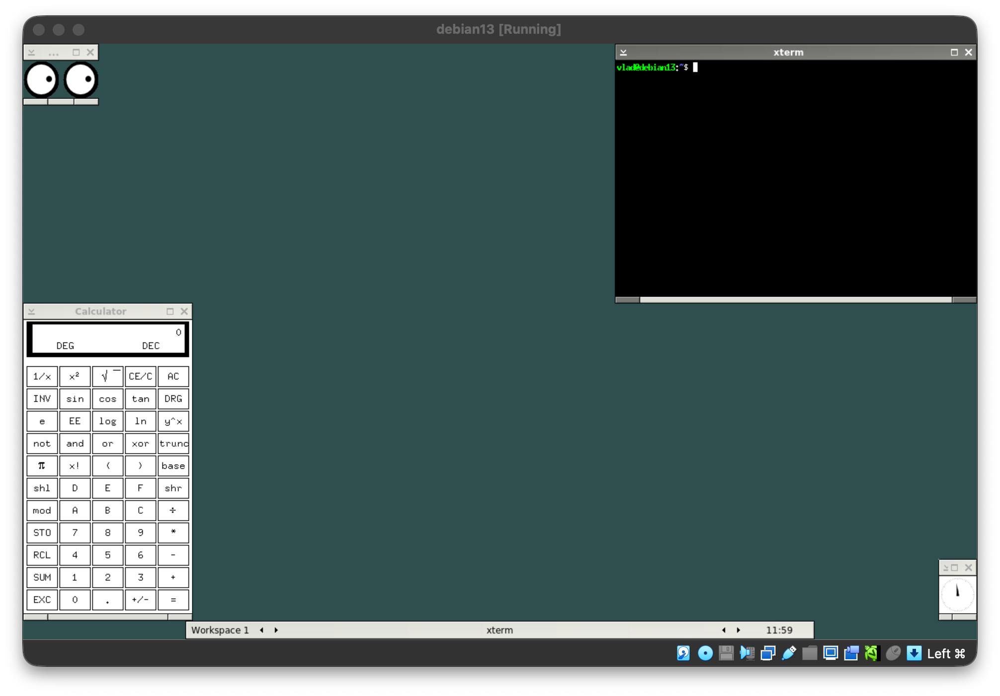
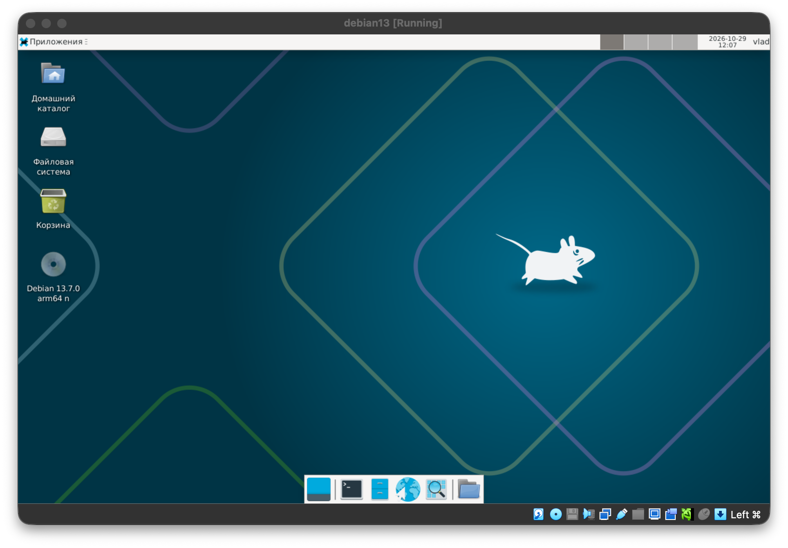
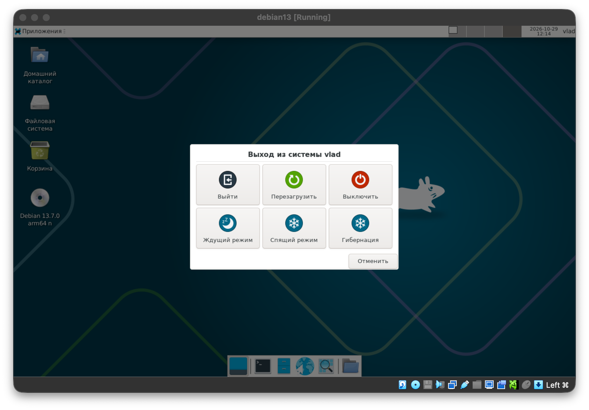
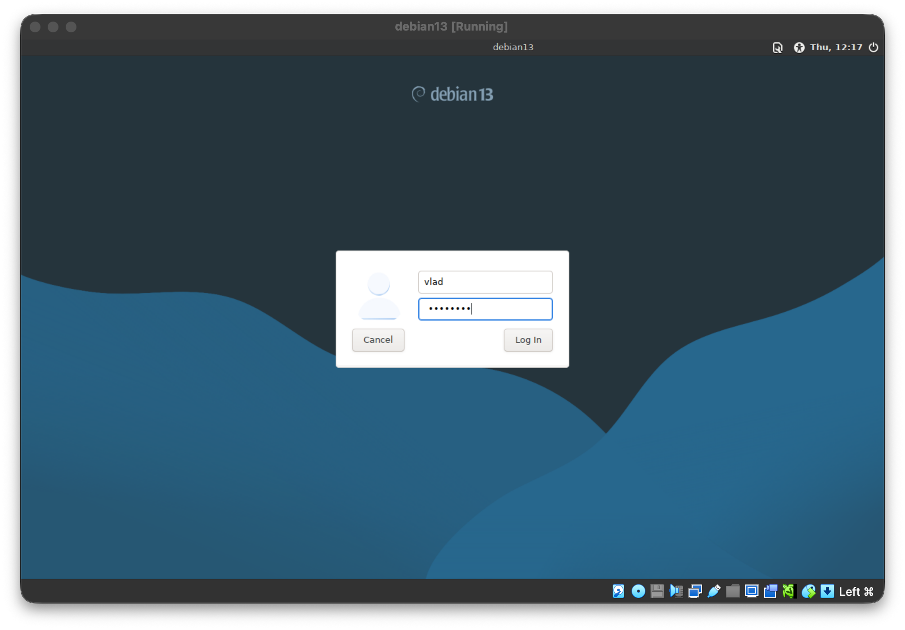
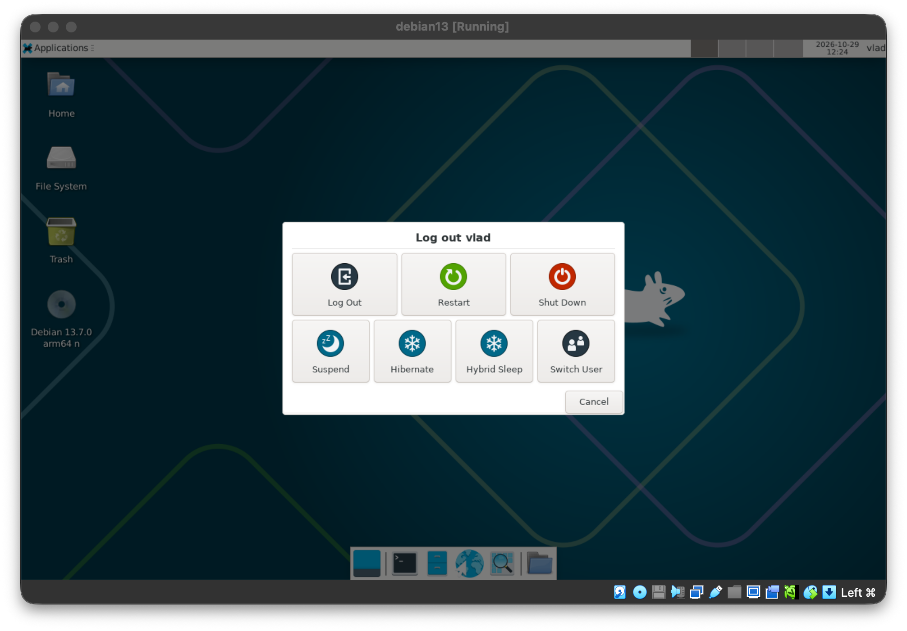

[//]: # (Работа сдана)

# Лабораторная работа 10. Система X Window

> Примечание: при выполнении лабораторной в среде MacOS X или WSL требуется установить дополнительно X server.

## Упражнение 10.1. Создание собственного настольного окружения

### 1. Установите оконный менеджер blackbox:

```bash
vlad@debian13:~$ sudo apt install -y xorg blackbox x11-xserver-utils xterm x11-apps xcalc xinit
[...]
Обрабатываются триггеры для man-db (2.13.1-1) …
Обрабатываются триггеры для udev (257.13-1~deb13u1) …
Обрабатываются триггеры для mailcap (3.74) …
Обрабатываются триггеры для libc-bin (2.41-12+deb13u3) …
xterm: No absolute path found for shell: x11-apps
vlad@debian13:~$ 
```

### 2. Отредактируйте сценарий командного интерпретатора .xinitrc в домашней директории пользователя student, сформировать собственное окружение, путем задания в данном сценарии команд запуска клиентов:

* a. xsetroot, для установки цвета darkslategray корневого окна:

```bash
xsetroot -solid darkslategray &
```

* b. xterm в правом верхнем углу экрана, цвет символов white на фоне black:

```bash
xterm -fg white -bg black -geometry 80x24-0+0 &
```

* c. xeyes в левом верхнем углу экрана, размером 100 x 50 пикселов:

```bash
xeyes -geometry 100x50+0+0 &
```

* d. xclock в правом нижнем углу экрана, размером 50 x 50 пикселов:

```bash
xclock -geometry 50x50-0-0 &
```

* e. xcalc в левом нижнем углу экрана:

```bash
xcalc -geometry +0-0 &
```

Итоговый `~/.xinitrc`:

```bash
vlad@debian13:~$ cat ~/.xinitrc
xsetroot -solid darkslategray &
xterm -fg white -bg black -geometry 80x24-0+0 &
xeyes -geometry 100x50+0+0 &
xclock -geometry 50x50-0-0 &
xcalc -geometry +0-0 &
exec blackbox
```

### 3. Запустите графическую подсистему X Window, отметьте какое настольное окружение пользователя активизировалось:

```bash
vlad@debian13:~$ startx
```

Активизировалось пользовательское окружение на базе оконного менеджера **blackbox** (запущен через `exec blackbox` в `~/.xinitrc`) с клиентами xterm, xeyes, xclock и xcalc:



---

## Упражнение 10.2. Настройка настольного окружения Xfce

### 1. Создайте сценарий командного интерпретатора .xinitrc в домашней директории пользователя student таким, чтобы при запуске графической системы X Window всегда активизировалось настольное окружение Xfce:

```bash
vlad@debian13:~$ sudo apt install -y xfce4
[...]
Настраивается пакет xiccd (0.4.1-1) …
Настраивается пакет mate-polkit (1.26.1-4+b2) …
Обрабатываются триггеры для libgdk-pixbuf-2.0-0:arm64 (2.42.12+dfsg-4+deb13u1) …
vlad@debian13:~$ echo 'exec startxfce4'>~/.xinitrc
vlad@debian13:~$ cat ~/.xinitrc
exec startxfce4
vlad@debian13:~$ startx
```

### 2. Настройте активизировавшееся настольное окружение Xfce по своему вкусу.



### 3. Закончите графический сеанс работы в операционной системе.

Через меню «Приложения» выбран пункт выхода из системы, в появившемся диалоге нажата кнопка «Выйти»:



---

## Упражнение 10.3. Графический вход в систему

> Примечание: в случае если в ОС установлен графический вход в систему по умолчанию, то требуется указать какой
> используется менеджер дисплеев.

Используется менеджер дисплеев **LightDM** (`/usr/sbin/lightdm`).

### 1. Настройте автоматический запуск графической среды с использованием менеджера дисплеев:

```bash
vlad@debian13:~$ sudo apt install -y lightdm
Уже установлен пакет lightdm самой новой версии (1.32.0-6+b2).    
lightdm помечен как установленный вручную.
Сводка:
Обновление: 0, Установка: 0, Удаление: 0, Пропуск обновления: 38
vlad@debian13:~$ cat /etc/X11/default-display-manager
/usr/sbin/lightdm
vlad@debian13:~$ sudo systemctl enable lightdm
Synchronizing state of lightdm.service with SysV service script with /usr/lib/systemd/systemd-sysv-install.
Executing: /usr/lib/systemd/systemd-sysv-install enable lightdm
vlad@debian13:~$ sudo systemctl set-default graphical.target
Created symlink '/etc/systemd/system/default.target' → '/usr/lib/systemd/system/graphical.target'.
vlad@debian13:~$ sudo reboot
```

### 2. Перезагрузите операционную систему. Убедитесь, что доступен графический вход в систему. Используйте настольное окружение Xfce при входе в систему.

После перезагрузки отображается графический экран входа LightDM:



После ввода логина и пароля выполнен вход, активизировалось настольное окружение Xfce:


### 3. Закончите графический сеанс работы в операционной системе.

Сеанс завершается через диалог выхода (кнопка Log Out):


