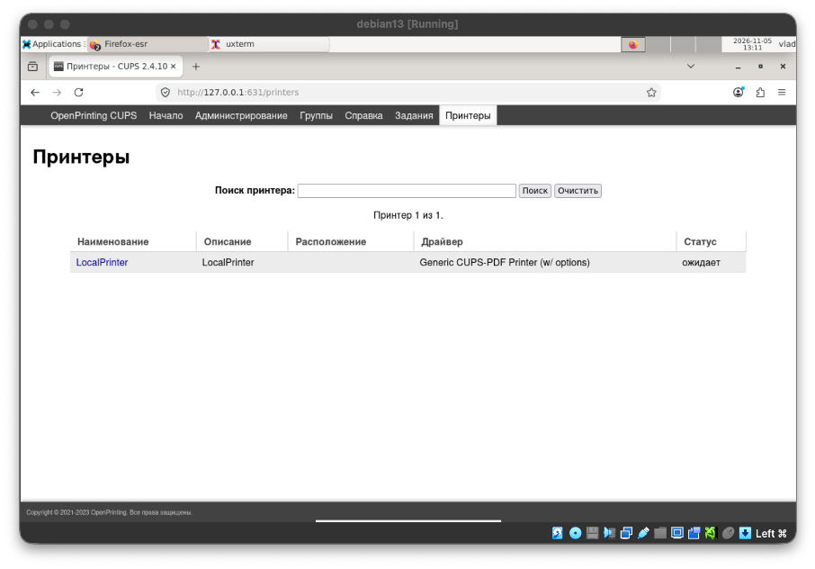
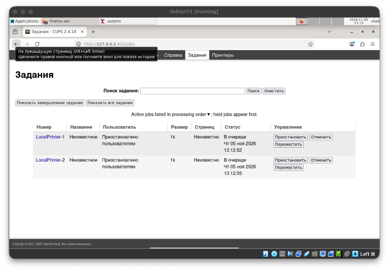
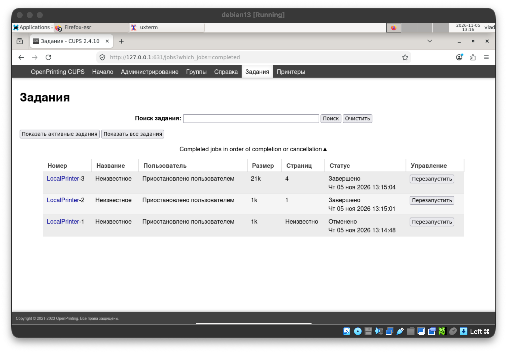
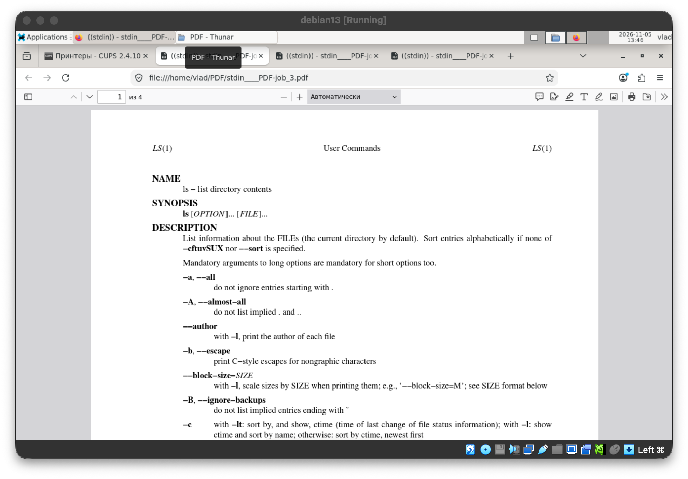
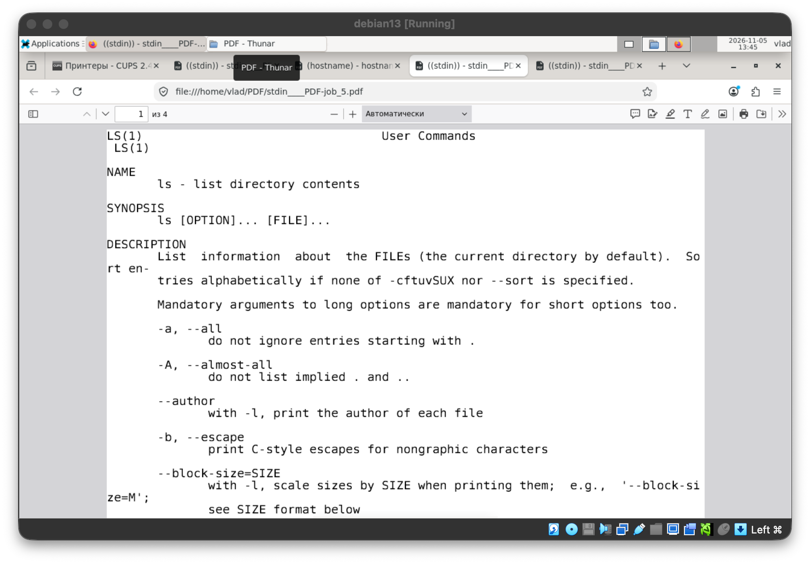

[//]: # (Работа сдана)

# Лабораторная работа 11. Подсистема печати

> **CUPS** (Common UNIX Printing System) — стандартная подсистема печати в Linux и macOS.
>
> * **Планировщик `cupsd`** принимает задания, ставит их в очереди (по одной на принтер) и передаёт на печать. Он
>   слушает порт **631** по протоколу IPP (Internet Printing Protocol); на том же порту работает веб-интерфейс
>   администрирования.
> * **Фильтры** (`cups-filters`, `ghostscript`) преобразуют входной файл (текст, PostScript, PDF, изображение) в
>   формат, понятный принтеру.
> * **Драйвер (PPD-файл)** описывает возможности конкретной модели принтера.
> * **Бэкенд** доставляет готовые данные устройству: `usb:/`, `ipp://`, `socket://`, или — как в этой работе —
>   виртуальному «принтеру» `cups-pdf:/`, который сохраняет результат в PDF-файл.
> * Для работы с очередями есть два набора команд: **BSD** (`lpr`, `lpq`, `lprm`) и **System V** (`lp`, `lpstat`,
>   `cancel`).

## Упражнение 11.1. Средства печати UNIX

### 1. Установите систему печати cups:

```bash
vlad@debian13:~$ sudo apt update
Сущ:1 http://deb.debian.org/debian trixie InRelease
Пол:2 http://security.debian.org/debian-security trixie-security InRelease [43,4 kB]
Пол:3 http://deb.debian.org/debian trixie-updates InRelease [47,3 kB]
...
Получено 865 kB за 1с (971 kB/s)
Может быть обновлено 46 пакетов. Запустите «apt list --upgradable» для их показа.
vlad@debian13:~$ sudo apt install cups
Уже установлен пакет cups самой новой версии (2.4.10-3+deb13u2).
Сводка:
  Обновление: 0, Установка: 0, Удаление: 0, Пропуск обновления: 46
vlad@debian13:~$ sudo systemctl enable --now cups
Synchronizing state of cups.service with SysV service script with /usr/lib/systemd/systemd-sysv-install.
Executing: /usr/lib/systemd/systemd-sysv-install enable cups
vlad@debian13:~$ sudo usermod -aG lpadmin vlad
vlad@debian13:~$ systemctl status cups
● cups.service - CUPS Scheduler
     Loaded: loaded (/usr/lib/systemd/system/cups.service; enabled; preset: enabled)
     Active: active (running) since Thu 2026-11-05 12:40:24 MSK; 2min 2s ago
TriggeredBy: ● cups.path
             ● cups.socket
       Docs: man:cupsd(8)
   Main PID: 691 (cupsd)
     Status: "Scheduler is running..."
```

### 2. Установите виртуальный драйвер для печати в PDF в систему печати cups:

```bash
vlad@debian13:~$ sudo apt install printer-driver-cups-pdf
Уже установлен пакет printer-driver-cups-pdf самой новой версии (3.0.2-3).
Сводка:
  Обновление: 0, Установка: 0, Удаление: 0, Пропуск обновления: 46
vlad@debian13:~$ sudo systemctl restart cups
```

### 3. Используя браузер в графической среде, зайдите по адресу http://127.0.0.1:631 и добавьте принтер с именем LocalPrinter использующий драйвер PDF.

Принтер `LocalPrinter` добавлен через веб-интерфейс CUPS:



### 4. При помощи команд lpr, lpq, lprm (lp, lpstat, cancel):

* a. просмотрите состояния принтера с именем LocalPrinter:

```bash
vlad@debian13:~$ lpstat -p
принтер LocalPrinter свободен. Включен с момента Чт 05 ноя 2026 13:10:04
vlad@debian13:~$ lpstat -p LocalPrinter
принтер LocalPrinter свободен. Включен с момента Чт 05 ноя 2026 13:10:04
```

* b. распечатайте любой файл на принтере LocalPrinter, проследите за сообщениями:

```bash
vlad@debian13:~$ sudo cupsdisable LocalPrinter
vlad@debian13:~$ lpr -P LocalPrinter /etc/hostname
vlad@debian13:~$ lp -d LocalPrinter /etc/hostname
id запроса LocalPrinter-2 (1 файл.)
```

* c. просмотрите состояния принтера LocalPrinter, проследите за сообщениями:

```bash
vlad@debian13:~$ lpq -P LocalPrinter
LocalPrinter не готов
Ранг    Владелец   Задание     Файл(ы)                     Общий размер
1st     vlad    1       hostname                        1024 байт
2nd     vlad    2       hostname                        1024 байт
vlad@debian13:~$ lpstat -p LocalPrinter
принтер LocalPrinter отключен с момента Чт 05 ноя 2026 13:10:58 -
	Paused
```



* d. удалите задание на печать из очереди принтера LocalPrinter, проследите за сообщениями:

```bash
vlad@debian13:~$ lprm -P LocalPrinter 1
vlad@debian13:~$ lpq -P LocalPrinter
LocalPrinter не готов
Ранг    Владелец   Задание     Файл(ы)                     Общий размер
1st     vlad    2       hostname                        1024 байт
```

* e. распечатайте любую известную страницу руководства man на принтере LocalPrinter, проследите за сообщениями:

```bash
vlad@debian13:~$ sudo cupsenable LocalPrinter
vlad@debian13:~$ man -t ls | lpr -P LocalPrinter
vlad@debian13:~$ lpq -P LocalPrinter
LocalPrinter готов и печатает
Ранг    Владелец   Задание     Файл(ы)                     Общий размер
active  vlad    3       (stdin)                         21504 байт
vlad@debian13:~$ lpstat -t
планировщик запущен
Нет назначение системы по умолчанию
устройство для LocalPrinter: cups-pdf:/
LocalPrinter принимает запросы с момента Чт 05 ноя 2026 13:15:04
принтер LocalPrinter свободен. Включен с момента Чт 05 ноя 2026 13:15:04
vlad@debian13:~$ ls ~/PDF
hostname__PDF-job_2.pdf  stdin____PDF-job_3.pdf
```



man -t ls:



man ls:


