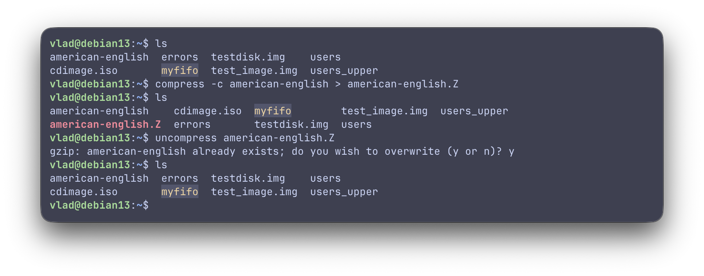
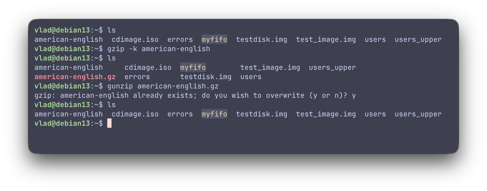
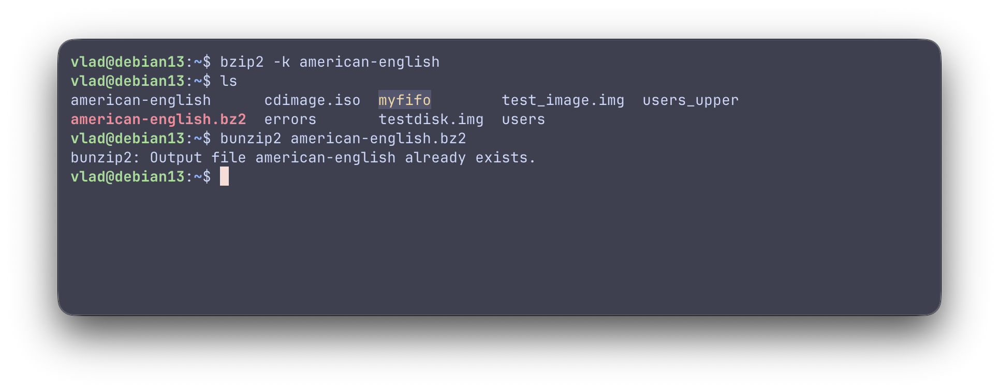
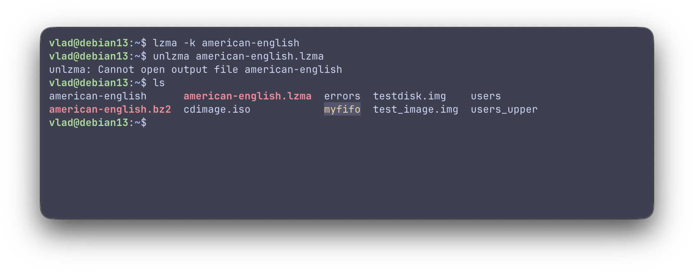
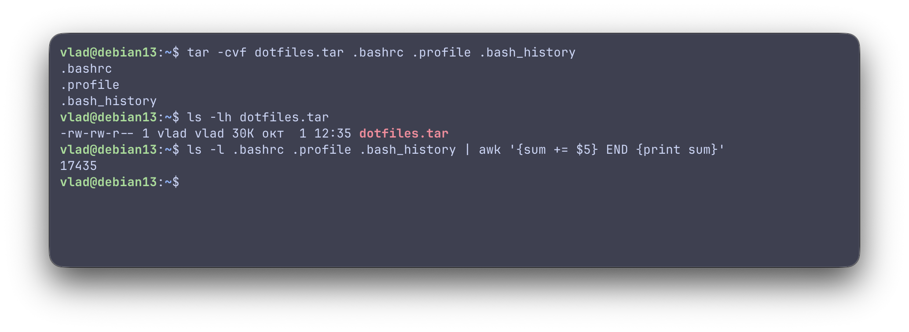
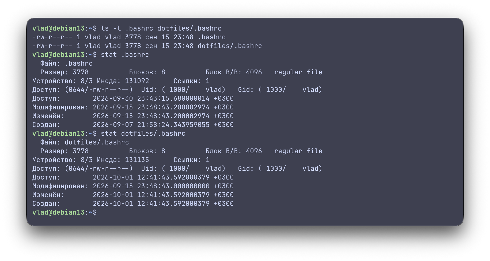
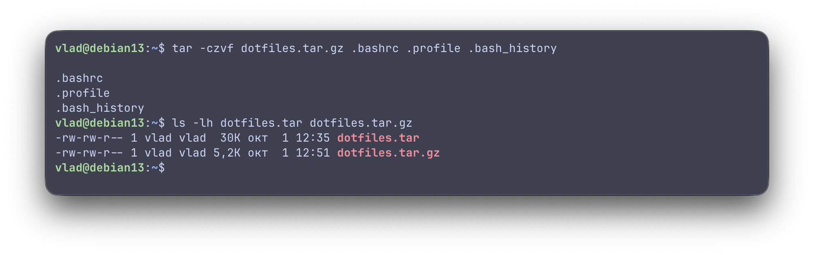
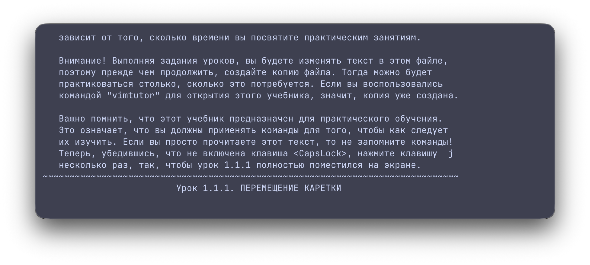

# Лабораторная работа 7. Инструментальные средства UNIX

## Упражнение 7.1. Упаковщики и архиваторы UNIX

### 1. При помощи команд упаковки compress, uncompress, gzip, gunzip, bzip2, lzma упакуйте один и тот же файл (например, /usr/share/dict/american-english, скопировав предварительно в домашний каталог) несколько раз. Примечание 1: если файл для сжатия отсутствует, то скачайте любой словарь для проверки орфографии из сети интернет. Примечание 2: если отсутствуют команды упаковки установите их дополнительно через менеджер управления пакетами.

> *Упаковка (compression)* — уменьшение размера одного файла за счёт устранения избыточности в данных (`compress`,
> `gzip`, `bzip2`, `lzma`). Работает с содержимым одного потока байтов.

- Устаревшие команды (Классический UNIX):
    - `compress` — Сжимает файлы с помощью алгоритма LZW. Это старая классическая утилита UNIX. Сегодня она практически
      не используется, так как уступает современным аналогам по степени сжатия. После обработки заменяет исходный файл
      файлом с расширением `.Z`
    - `uncompress` — Распаковывает файлы, сжатые с помощью `compress` (с расширением `.Z`), и возвращает им исходный
      вид
- Стандартные команды (Универсальные):
    - `gzip (GNU zip)` — Самая популярная утилита для сжатия в Linux/UNIX. Использует алгоритм Deflate. Работает очень
      быстро и потребляет мало памяти, обеспечивая хорошее сжатие. По умолчанию заменяет исходный файл на файл с
      расширением `.gz`
    - `gunzip` — Распаковывает файлы, сжатые утилитой `gzip` (а также файлы `.gz`,` .z`, `.tgz`)
- Команды с повышенным сжатием (Продвинутые):
    - `bzip2` — Сжимает файлы с помощью алгоритма Берроуза-Уилера. Она сжимает файлы эффективнее, чем `gzip`, но
      работает заметно медленнее и требует больше процессорного времени. Создает файлы с расширением `.bz2`
    - `lzma` — Сжимает файлы на базе алгоритма LZMA (Lempel-Ziv-Markov chain-algorithm). Обеспечивает очень высокую
      степень сжатия (сильнее, чем `gzip` и `bzip2`), но требует много оперативной памяти и времени на упаковку. Создает
      файлы с расширением `.lzma`


*Упаковка и распаковка с использованием команды `compress` и `uncompress`*

`-c (compress -c american-english)` - утилита сжимает файл, но не трогает оригинал и не создаёт файл сама. Она просто
«выбрасывает» сжатые бинарные данные прямо в консоль.


*Упаковка и распаковка с использованием команды `grip` и `gunzip`*

`-k (keep)` - сохраняет исходный файл, иначе gzip заменяет его сжатым


*Упаковка и распаковка с использованием команды `bzip2` и `bunzip2`*


*Упаковка и распаковка с использованием команды `lzma` и `unlzma`*

Сравните скорость и качество упаковки:

```bash
vlad@debian13:~$ time compress -c american-english-compress > american-english-compress.Z
real    0m0,035s
user    0m0,018s
sys     0m0,015s

vlad@debian13:~$ time gzip american-english-gz
real    0m0,099s
user    0m0,082s
sys     0m0,015s

vlad@debian13:~$ time bzip2 american-english-bz2
real    0m0,097s
user    0m0,083s
sys     0m0,012s

vlad@debian13:~$ time lzma american-english-lzma
real    0m0,172s
user    0m0,150s
sys     0m0,020s

vlad@debian13:~$ ls -lh american-english*
-rw-r--r-- 1 vlad vlad 962K окт  1 00:36 american-english
-rw-r--r-- 1 vlad vlad 345K окт  1 00:37 american-english-bz2.bz2
-rw-r--r-- 1 vlad vlad 962K окт  1 00:36 american-english-compress
-rw-rw-r-- 1 vlad vlad 421K окт  1 00:38 american-english-compress.Z
-rw-r--r-- 1 vlad vlad 962K окт  1 00:37 american-english-gz
-rw-r--r-- 1 vlad vlad 264K окт  1 00:38 american-english-gzip.gz
-rw-r--r-- 1 vlad vlad 211K окт  1 00:37 american-english-lzma.lzma
```

### Сравнение скорости и качества упаковки файлов

| Утилита (Алгоритм)          | Время сжатия (`real`), сек | Итоговый размер файла, КБ | Степень сжатия (% от оригинала) | Эффективность упаковки                                 |
|:----------------------------|:--------------------------:|:-------------------------:|:-------------------------------:|:-------------------------------------------------------|
| **Оригинал (без сжатия)**   |             —              |          962 КБ           |              100%               | Исходный текстовый файл                                |
| **compress** (LZW)          |        **0.035 с**         |          421 КБ           |              43.8%              | Самая высокая скорость, но худшее качество сжатия      |
| **gzip** (Deflate)          |          0.099 с           |          264 КБ           |              27.4%              | Отличный баланс скорости и уменьшения размера          |
| **bzip2** (Берроуза-Уилера) |          0.097 с           |          345 КБ           |              35.8%              | Средняя скорость и среднее качество сжатия текста      |
| **lzma** (LZMA)             |          0.172 с           |        **211 КБ**         |            **21.9%**            | Самая низкая скорость, но максимальное качество сжатия |

### 2. При помощи команды архивации tar выполните несколько операций архивирования:

> *Архивация (archiving)* — объединение нескольких файлов (с сохранением структуры каталогов, прав доступа, владельцев)
> в один файл-контейнер, без обязательного сжатия (`tar`, `cpio`). Само слово `tar` — сокращение от tape archive,
> унаследовано от эпохи ленточных накопителей, где нужно было последовательно записать множество файлов на одну
> физическую ленту

- Флаги:
    - `c (create)` — создать новый архив
    - `v (verbose)` — построчно выводить имена обрабатываемых файлов
    - `f (file)` — указывает, что следующий аргумент — имя файла архива

* a. создайте архив dotfiles.tar содержащий файлы .bashrc, .bash_profile, .bash_history, сравните размер архива и
  суммарный размер файлов:



Неупакованный `tar-архив` обычно больше, чем сумма размеров исходных файлов — потому что `tar` добавляет служебные
заголовки (header) для каждого файла (имя, права, владелец, размер, временные метки и т.д.) и выравнивает данные по
границам блоков (по умолчанию блок 512 байт), что создаёт дополнительные накладные расходы, особенно заметные на
маленьких файлах.

* b. разархивируйте полученный архив dotfiles.tar в каталог dotfiles, сравните атрибуты (разрешения, владельцев, время
  создания) исходных файлов, и файлов из архива:

```bash
mkdir dotfiles
tar -xvf dotfiles.tar -C dotfiles
```

- `x (extract)` — извлечь содержимое архива
- `-C dotfiles` — сменить рабочий каталог для распаковки (change directory), чтобы файлы не перемешались с оригиналами в
  домашнем каталоге



`tar` по умолчанию сохраняет права доступа и время модификации (mtime) исходных файлов внутри архива и восстанавливает
их при извлечении. Владелец и группа тоже обычно сохраняются в метаданных архива, но при распаковке обычным
пользователем (не root) реальный владелец восстановленных файлов будет тем, кто выполняет распаковку.

* c. создайте упакованный архив (непосредственно командой tar) dotfiles.tar.gz, сравните его размер с размером
  неупакованного архива dotfiles.tar и суммарным размером файлов архива:



Добавлен флаг `z` — указывает `tar` пропустить создаваемый архив через `gzip` «на лету», не создавая промежуточный
несжатый `.tar` файл отдельно.

`dotfiles.tar.gz` заметно меньше как неупакованного `dotfiles.tar`, так и суммарного размера исходных файлов. Сжатие
применяется ко всему архиву целиком как единому потоку байт после объединения файлов, а не к каждому файлу отдельно до
архивации — отсюда лучшая эффективность сжатия для множества маленьких похожих файлов

* d. разархивируйте упакованный архив dotfiles.tar.gz в каталог dotfiles-:

```bash
mkdir dotfiles-
tar -xzvf dotfiles.tar.gz -C dotfiles-
```

Флаг `z` - `tar` сначала пропустить входной поток через `gunzip`, прежде чем разбирать его как tar-архив.

Результат распаковки `dotfiles.tar.gz`  идентичен результату распаковки обычного `dotfiles.tar`  — сжатие не влияет на
конечное содержимое и атрибуты файлов.

## Упражнение 7.2. Текстовые редакторы UNIX

### 1. При помощи команды vimtutor ru ознакомьтесь с принципами работы в редакторе vim и зафиксируйте основные команды:

> `vimtutor` — встроенный интерактивный самоучитель

`sudo apt install vim` - установка `vim`



* a. команды посимвольного перемещения курсора:

| Клавиша | Направление движения | Описание                                |
|:-------:|:---------------------|:----------------------------------------|
|  **h**  | Влево                | Перемещает курсор на один символ влево  |
|  **j**  | Вниз                 | Перемещает курсор на одну строку вниз   |
|  **k**  | Вверх                | Перемещает курсор на одну строку вверх  |
|  **l**  | Вправо               | Перемещает курсор на один символ вправо |

* b. команды пословного перемещения курсора:

|   Клавиша   | Направление    | Описание действия                                            | Пример поведения                                                                                                             |
|:-----------:|:---------------|:-------------------------------------------------------------|:-----------------------------------------------------------------------------------------------------------------------------|
|    **w**    | `word forward` | Перемещает курсор **к началу следующего слова**.             | Считает знаки препинания отдельными словами (например, в `test.txt` курсор встанет на точку).                                |
|    **b**    | `back`         | Перемещает курсор **к началу предыдущего слова**.            | Возвращает курсор назад, также учитывая пунктуацию как разделители.                                                          |
|    **e**    | `end`          | Перемещает курсор **к концу текущего** или следующего слова. | Останавливает курсор на последней букве слова перед знаком препинания.                                                       |
| **W, B, E** | `WORD`         | Выполняют **то же самое**, но игнорируют пунктуацию.         | Разделителями считаются **только пробелы и символы новой строки** (строка `test.txt` будет воспринята как одно целое слово). |

* c. команды постраничного листания:

|      Клавиша      | Направление | Описание действия                                                                          |
|:-----------------:|:------------|:-------------------------------------------------------------------------------------------|
|   **Ctrl + F**    | `forward`   | Перемотать на **одну страницу вперёд** (вниз).                                             |
|   **Ctrl + B**    | `back`      | Перемотать на **одну страницу назад** (вверх).                                             |
|   **Ctrl + D**    | `down`      | Перемотать на **полстраницы вниз**.                                                        |
|   **Ctrl + U**    | `up`        | Перемотать на **полстраницы вверх**.                                                       |
|      **gg**       | `go-go`     | Быстро переместить курсор **в самое начало файла** (на первую строку).                     |
|       **G**       | `Go`        | Быстро переместить курсор **в самый конец файла** (на последнюю строку).                   |
| **:N** или **NG** | `line Go`   | **Перейти к строке с номером N** (например: `:10` или `10G` переместит на десятую строку). |

* d. команды поиска текста:

| Команда     | Направление поиска | Описание действия                                                                                            |
|:------------|:-------------------|:-------------------------------------------------------------------------------------------------------------|
| **/шаблон** | Вперёд (вниз)      | Ищет указанный `шаблон` (текст или регулярное выражение) от текущей позиции курсора **вниз до конца файла**. |
| **?шаблон** | Назад (вверх)      | Ищет указанный `шаблон` от текущей позиции курсора **вверх до начала файла**.                                |

* e. команды повторения предыдущего поиска:

| Клавиша | Направление | Описание действия                                                                                                                       |
|:-------:|:------------|:----------------------------------------------------------------------------------------------------------------------------------------|
|  **n**  | `next`      | **Повторить поиск в том же направлении**, в котором он был запущен (вниз для `/` или вверх для `?`). Переходит к следующему совпадению. |
|  **N**  | `Next`      | **Повторить поиск в противоположном направлении**. Возвращает курсор к предыдущему найденному совпадению.                               |

* f. команды вставки текста:

| Клавиша | Позиция вставки | Описание действия                                                                                            |
|:-------:|:----------------|:-------------------------------------------------------------------------------------------------------------|
|  **i**  | `insert`        | Переходит в режим вставки **перед текущим положением курсора**.                                              |
|  **a**  | `append`        | Переходит в режим вставки **после текущего положения курсора** (удобно для добавления текста в конец слова). |
|  **I**  | `Insert line`   | Перемещает курсор в **самое начало текущей строки** и сразу включает режим вставки.                          |
|  **A**  | `Append line`   | Перемещает курсор в **самый конец текущей строки** и сразу включает режим вставки.                           |
|  **o**  | `open below`    | Создает (открывает) **новую пустую строку ниже** текущей и сразу переводит курсор в режим вставки на ней.    |
|  **O**  | `open above`    | Создает (открывает) **новую пустую строку выше** текущей и сразу переводит курсор в режим вставки на ней.    |

* g. команды удаления текста:

| Клавиша / Команда | Объект удаления | Описание действия                                                                                                      |
|:-----------------:|:----------------|:-----------------------------------------------------------------------------------------------------------------------|
|       **x**       | `character`     | Удаляет **один символ**, находящийся прямо под курсором.                                                               |
|      **dd**       | `delete line`   | Полностью удаляет **всю текущую строку**, на которой стоит курсор (строка вырезается в буфер).                         |
|      **dw**       | `delete word`   | Удаляет текст **от текущей позиции курсора до начала следующего слова** (включая пробел после слова).                  |
|       **D**       | `Delete to end` | Удаляет весь текст **от курсора и до самого конца текущей строки**.                                                    |
|      **d\$**      | `delete to $`   | Выполняет **то же самое, что и D**. Удаляет текст от курсора до конца строки (`$` — это спецсимвол конца строки в vi). |

* h. команды захвата текста:

| Клавиша / Команда | Объект копирования | Описание действия                                                                                             |
|:-----------------:|:-------------------|:--------------------------------------------------------------------------------------------------------------|
|      **yy**       | `yank line`        | Полностью копирует («захватывает») **всю текущую строку**, на которой находится курсор, в буфер обмена.       |
|      **yw**       | `yank word`        | Копирует часть текста **от текущей позиции курсора до начала следующего слова**.                              |
|      **y\$**      | `yank to $`        | Копирует весь текст **от текущей позиции курсора и до самого конца строки** (`$` — обозначение конца строки). |

* i. команды вставки захваченного текста:

| Клавиша | Позиция вставки | Описание действия                                                                                                                                               |
|:-------:|:----------------|:----------------------------------------------------------------------------------------------------------------------------------------------------------------|
|  **p**  | `put after`     | **Вставить текст после курсора** (если в буфере символы или слова) или **строкой ниже** текущей (если в буфере находится целая скопированная/удаленная строка). |
|  **P**  | `Put before`    | **Вставить текст перед курсором** (если в буфере символы или слова) или **строкой выше** текущей (если в буфере находится целая строка).                        |

* j. команды записи текста в файл:

| Команда          |       Режим работы       | Описание действия                                                                                                           |
|:-----------------|:------------------------:|:----------------------------------------------------------------------------------------------------------------------------|
| **:w**           |  Режим командной строки  | **Сохранить изменения** в текущем файле (`write`), не закрывая редактор.                                                    |
| **:w имя_файла** |  Режим командной строки  | **Сохранить как новый файл** с указанным именем (оригинальный файл останется без изменений).                                |
| **:wq**          |  Режим командной строки  | **Сохранить изменения и выйти** из редактора (`write` + `quit`).                                                            |
| **ZZ**           | Командный (Normal) режим | Выполняет **то же самое, что и `:wq`**, но работает быстрее, так как не требует ввода двоеточия и перехода в строку команд. |

* k. команды чтения файла:

`:r имя_файла` - Вставляет содержимое указанного файла в текущий буфер редактирования, начиная со строки после курсора —
полезно для объединения файлов прямо во время редактирования.

* l. команды выхода из редактора:

| Команда            |       Режим работы       | Описание действия                                                                                                                                                             |
|:-------------------|:------------------------:|:------------------------------------------------------------------------------------------------------------------------------------------------------------------------------|
| **:q**             |  Режим командной строки  | **Выйти из редактора** (`quit`). Сработает только в том случае, если в файле нет несохранённых изменений. Если изменения были, Vim выдаст предупреждение.                     |
| **:q!**            |  Режим командной строки  | **Выйти без сохранения, принудительно** (`force quit`). Игнорирует любые изменения и закрывает файл, возвращая терминал в исходное состояние.                                 |
| **:wq** или **:x** |  Режим командной строки  | **Сохранить изменения и выйти**. Команда `:x` (exit) является синонимом `:wq`, но записывает файл на диск только в том случае, если в него действительно вносились изменения. |
| **ZZ**             | Командный (Normal) режим | **Сохранить изменения и выйти**. Быстрый аналог `:wq`, выполняемый прямо из командного режима без ввода двоеточия.                                                            |

### 2. При помощи редактора vim отредактируйте файл .plan, куда внесите информацию о себе.

